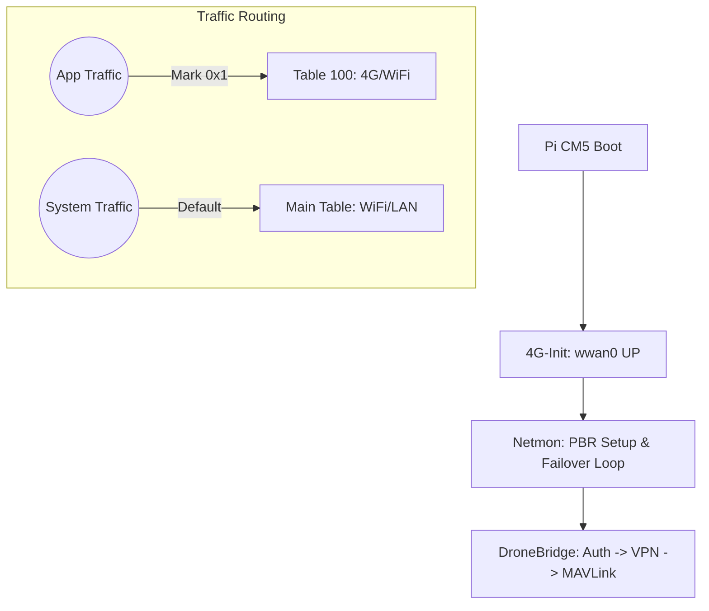

# 🚁 DroneBridge Service — Pi CM5 Edition

**DroneBridge Service** là giải pháp truyền tải dữ liệu MAVLink hiệu năng cao dành riêng cho nền tảng **Raspberry Pi CM5**, đóng vai trò là cầu nối (Bridge) thông minh giữa Drone và hệ thống **QCC Cloud Control Station**.


---

## 🌟 Tính Năng Cốt Lõi

*   **Kết nối MAVLink Siêu Ổn Định**: Truyền tải dữ liệu telemetry và điều khiển qua tunnel VPN (WireGuard), tối ưu hóa cho đường truyền **4G (wwan0)**.
*   **Cơ chế Fail-over Thông Minh**: Tự động chuyển đổi giữa 4G và WiFi. Ưu tiên 4G, chỉ fallback sang WiFi khi mất sóng và tự động quay lại khi có tín hiệu.
*   **Policy-Based Routing (PBR)**: Tách biệt hoàn toàn traffic ứng dụng và traffic hệ thống. Giữ kết nối SSH qua WiFi luôn ổn định kể cả khi DroneBridge đang sử dụng 4G.
*   **Bảo Mật Đa Lớp**: Xác thực HMAC-SHA256 trên kênh công cộng (TCP 5770) trước khi thiết lập tunnel bảo mật WireGuard.
*   **Fail-closed Security**: Chặn rò rỉ dữ liệu quan trọng qua các giao diện mạng không an toàn thông qua cấu hình Firewall nghiêm ngặt.

---

## 🏗️ Kiến Trúc Hệ Thống (3 Tầng)

Hệ thống được vận hành bởi 3 dịch vụ phối hợp nhịp nhàng:

| Tầng | Dịch vụ (Systemd) | Chức năng chính |
| :--- | :--- | :--- |
| **1. Hardware** | `dronebridge-4g-init` | Khởi tạo modem 4G (QMI), cấp phát IP cho `wwan0`. |
| **2. Policy** | `dronebridge-netmon` | Quản lý bảng định tuyến (Table 100) và thực hiện Fail-over. |
| **3. Application** | `dronebridge` | Xử lý MAVLink, thực hiện Auth và duy trì VPN Tunnel. |



---

## 🚀 Hướng Dẫn Cài Đặt & Triển Khai

### 1. Deploy tự động (Khuyên dùng)
Sử dụng script `deploy.sh` từ máy tính quản trị (Ubuntu/Debian) để build và cài đặt từ xa:

```bash
chmod +x deploy.sh
./deploy.sh pi@<pi-ip-address>
```
*Script sẽ tự động: Build binary → Sync source → Cài đặt Services → Cấu hình PBR.*

### 2. Docker — 1 lệnh deploy toàn bộ (khuyên dùng)

```bash
git clone git@github.com:annhhieu/Pi_CM5_DroneBridgeService.git
cd Pi_CM5_DroneBridgeService/docker
sudo bash setup.sh
```

**Chỉ 1 lệnh** — tự động:
1. Cài Docker (nếu chưa có)
2. Build & chạy container supervisor
3. `install.sh` → `/opt/dronebridge`
4. `run.sh` → đăng ký secret (nếu thiếu) + khởi động stack
5. Giám sát 60s/lần — service down hoặc auth lỗi → **tự sửa**
6. Boot lại máy → `drone-bootstrap.service` tự chạy lại

```bash
docker compose -f docker/docker-compose.yml logs -f   # theo dõi
```

`REPO_URL` trong `.env` để trống = dùng code local đã clone. Điền URL git nếu muốn auto-pull khi có commit mới.

### 3. Đăng ký Drone (Lần đầu duy nhất)
Để Drone có thể xác thực với Server, bạn cần đăng ký để nhận `secret_key`:

```bash
# Tạm dừng service nếu đang chạy
sudo systemctl stop dronebridge

# Chạy lệnh đăng ký
cd /opt/dronebridge
sudo ./dronebridge --config config.yaml --register

# Sau khi có key, khởi động lại
sudo systemctl start dronebridge
```

---

## 🛠️ Quản Lý & Vận Hành

### Kiểm tra trạng thái nhanh
Hệ thống cung cấp công cụ kiểm tra trạng thái mạng và định tuyến chi tiết:
```bash
sudo python3 /opt/dronebridge/Module_4G/connection_manager.py status
```

### Quản lý dịch vụ (Systemd)
```bash
# Xem trạng thái tất cả services liên quan
sudo systemctl status "dronebridge*"

# Restart toàn bộ hệ thống DroneBridge
sudo systemctl restart "dronebridge*"
```

### Theo dõi Log Real-time
| Mục tiêu log | Lệnh |
| :--- | :--- |
| **App Logic** | `journalctl -u dronebridge -f` |
| **Network/Failover** | `journalctl -u dronebridge-netmon -f` |
| **4G Hardware** | `journalctl -u dronebridge-4g-init -f` |

---

## 🔍 Xử Lý Sự Cố (Troubleshooting)

| Vấn đề | Nguyên nhân khả thi | Cách khắc phục |
| :--- | :--- | :--- |
| **Mất kết nối SSH khi bật app** | PBR chưa được cấu hình hoặc IP Rule bị mất. | Chạy `sudo /opt/dronebridge/setup_pbr.sh` hoặc restart `netmon`. |
| **Auth Timeout trên 4G** | Firewall chặn hoặc routing sai Table. | Kiểm tra `ip rule show` xem có fwmark 0x1 không. |
| **VPN không kết nối (WireGuard)** | Provisioning thất bại hoặc Server Public Key sai. | Xóa `vpn_config.json` và khởi động lại app để cấp mới. |
| **Dữ liệu MAVLink bị trễ (Latency)** | Đang chạy trên WiFi yếu thay vì 4G. | Kiểm tra status netmon, force restart 4G-init. |

---

## 📁 Cấu Trúc Thư Mục Tham Chiếu

*   `/opt/dronebridge/`: Thư mục cài đặt chính.
*   `config.yaml`: File cấu hình hệ thống (IP, Port, UUID).
*   `Module_4G/`: Chứa scripts quản lý phần cứng và routing.
*   `docs/`: Tài liệu chi tiết về kiến trúc ([SYSTEM_ARCHITECTURE.md](docs/SYSTEM_ARCHITECTURE.md), [STARTUP_FLOW.md](docs/STARTUP_FLOW.md), [NETWORK_MANAGEMENT.md](docs/NETWORK_MANAGEMENT.md)).
*   `logs/`: Lưu trữ log sự kiện mạng và binary logs.

---
*© 2026 QCC Cloud Control Station. All rights reserved.*
