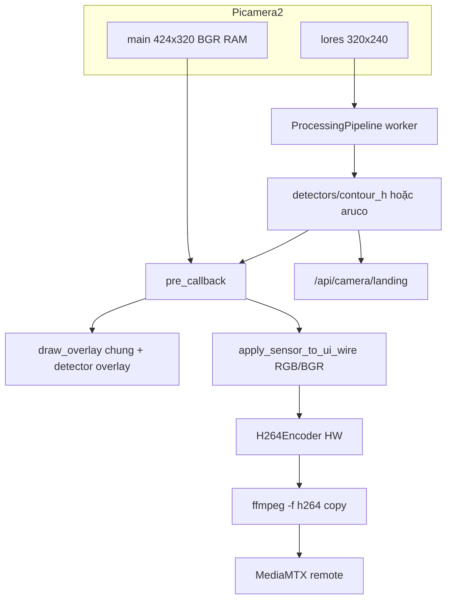

# Camera & Stream — Kiến trúc pipeline

> Cập nhật: **2026-06-24**  
> Trạng thái: **H264+CV path hoạt động ~30 FPS; detection tách folder `processing/detectors/`**  
> Đọc kèm: [CAMERA_KNOWN_ISSUES.md](./CAMERA_KNOWN_ISSUES.md) · [LANDING_DETECTION.md](./LANDING_DETECTION.md)

---

## 0. Tóm tắt nhanh

**Mỗi camera (cam0, cam1) dùng cùng mô hình:** Hướng 1 là luồng chính (capture → encode → RTSP); Hướng 2 là lớp phụ tùy config (`detection_enabled`, `overlay_enabled`). Đổi detector (`contour_h` ↔ `aruco`) **chỉ** đổi plugin Hướng 2 — không đổi pipeline của camera khác.

| Thành phần | Vai trò |
|------------|---------|
| **Hướng 1** | Capture → encode H.264 → FFmpeg copy → RTSP → MediaMTX → QCC |
| **Hướng 2** | CV trên **lores** (320×240), async — không block H1; overlay burn qua `pre_callback` main |
| **Entry** | `camera_streamer.py` — mỗi stream tự chọn: `h264_cv_loop` (H2 ON) → `rpicam-vid` HW (H2 OFF) → `capture_loop` |
| **Detection** | Plugin trong `processing/detectors/<mode>/` — xem [LANDING_DETECTION.md](./LANDING_DETECTION.md) |
| **Go launcher** | `streamer_launcher.go` — mỗi stream theo config riêng; dual-cam chỉ điều phối **thứ tự khởi động** (CV trước, HW sau) |

---

## 1. Hai hướng pipeline

```
┌─────────────────────────────────────────────────────────────────────────┐
│  HƯỚNG 1 — Stream (FPS ưu tiên)                                         │
│  Picamera2 main → H264Encoder → FFmpeg copy → RTSP                      │
│  pre_callback: overlay burn (nếu bật) + apply_sensor_to_ui_wire()       │
└─────────────────────────────────────────────────────────────────────────┘
                                    ▲
                         detection_result (latest)
┌─────────────────────────────────────────────────────────────────────────┐
│  HƯỚNG 2 — Xử lý ảnh (async, không block encode)                        │
│  lores BGR → ProcessingPipeline → detectors/<mode>/processor.py         │
└─────────────────────────────────────────────────────────────────────────┘
```

**Không nhầm:** `port-cam0-overlay` trong UI = chọn **sensor CSI** (OV5647/IMX219), không phải graphics overlay.

---

## 2. Luồng runtime cam1 (H2 ON — mặc định bay + landing)



File: `Find_landing/stream/h264_cv_loop.py`

| Bước | Module |
|------|--------|
| Khởi tạo camera + lores | `camera_manager.py` |
| Build pipeline | `processing/pipeline.py` → `registry.py` → `detectors/` |
| Overlay burn | `processing/overlay.py` + `detectors/*/overlay.py` |
| Wire format stream | `stream/wire_format.py` → `apply_sensor_to_ui_wire()` |
| Telemetry | `stream/metrics.py` → `/tmp/camera_landing_{id}.json` |

---

## 3. Luồng fallback (capture_loop)

Khi không có lores / H264 HW fail:

```
capture_source → [FrameGate nếu gate_timeout_ms > 0] → bgr_to_wire → libx264 FFmpeg → RTSP
```

File: `Find_landing/stream/capture_loop.py`

**Stream format** (`RGB888` / `BGR888`) có tác dụng rõ ở path này qua `bgr_to_wire()` + `wire_pixel_format()`.

---

## 4. Cấu trúc code (2026-06-24)

```
Find_landing/
├── camera_streamer.py       # Entry: chọn h264_cv_loop vs capture_loop
├── camera_manager.py        # Picamera2 singleton, lores, libcamera controls
├── find.py                  # Thuật toán gốc contour H (dùng bởi contour_h/)
├── stream/
│   ├── h264_cv_loop.py      # H2 ON: HW encode + lores CV
│   ├── capture_loop.py      # Fallback raw + x264
│   ├── wire_format.py       # BGR ↔ wire, sensor_to_bgr
│   └── metrics.py           # FPS stats, landing telemetry file
└── processing/
    ├── pipeline.py          # Worker queue maxsize=1
    ├── registry.py          # Chỉ gọi detectors — không chứa thuật toán
    ├── overlay.py           # Overlay chung (crosshair, offset, SEARCHING)
    ├── detect_config.py     # Đọc lores_size, frame_skip từ JSON
    └── detectors/
        ├── __init__.py      # MODE_ALIASES, load plugin
        ├── contour_h/       # Phương án 1
        └── aruco/           # Phương án 2
```

Go:

```
camera/streamer_launcher.go  → ghi camera_config_*.json
camera/stream_config.go      → landing_detection_mode, aruco_*, lores_size, ...
config/config.go             → camera.streams[] trong config.yaml
web/config_store.go          → UI Save → yaml
```

---

## 5. Config Hướng 2 (camera_config_*.json)

| Field | Mô tả | Mặc định |
|-------|--------|----------|
| `detection_enabled` | Bật CV worker | `true` cam1 |
| `overlay_enabled` | Overlay processor | `true` |
| `overlay_burn_enabled` | Vẽ pixel lên stream H264 | `true` |
| `landing_detection_mode` | `contour_h` \| `aruco` | `contour_h` |
| `detection_threshold` | Ngưỡng matchShapes (contour_h) | `0.8` |
| `landing_fullframe_fallback` | recognize_H toàn khung (contour_h) | `true` |
| `aruco_marker_id` | ID marker (aruco) | `0` |
| `aruco_dictionary` | OpenCV dict (aruco) | `DICT_4X4_50` |
| `lores_size` | Kích thước CV | auto từ resolution |
| `detect_frame_skip` | Detect mỗi N frame | `3` |
| `overlay_frame_skip` | Overlay processor skip | `5` |
| `gate_timeout_ms` | `0` = latest async (h264 path) | `0` |
| `format` | Stream wire RGB/BGR (xem §6) | `BGR888` |

---

## 6. Stream format (RGB888 vs BGR888)

| Path | `format` có tác dụng? |
|------|------------------------|
| **h264_cv_loop** (cam1 H2 ON) | Có — `apply_sensor_to_ui_wire()` trong `pre_callback` trước HW encode |
| **capture_loop** (raw) | Có — `bgr_to_wire()` + FFmpeg `-pix_fmt` |

Picamera2 libcamera luôn capture byte **B,G,R** trong RAM.  
**BGR888** = không đổi kênh (màu đúng). **RGB888** = hoán R↔B trên buffer trước encode.

CV lores: luôn `sensor_frame_to_bgr()` — **độc lập** với `format` UI.

---

## 7. API & telemetry

```bash
curl -s http://127.0.0.1:8080/api/camera/status | python3 -m json.tool
curl -s http://127.0.0.1:8080/api/camera/landing?camera_id=1 | python3 -m json.tool
cat /tmp/camera_landing_1.json
cat /tmp/camera_stream_stats_1.json
```

Restart stream:

```bash
curl -X POST http://127.0.0.1:8080/api/camera/restart
```

---

## 8. Deploy runtime

```bash
bash scripts/sync-runtime.sh
docker restart dronebridge
curl -X POST http://127.0.0.1:8080/api/camera/restart
```

Sync **không** ghi đè: `/opt/dronebridge/config.yaml`, `camera_config_*.json`.

---

## 9. Nhóm tính năng đã triển khai

| ID | Nội dung | Trạng thái |
|----|----------|------------|
| II-5 | Config + UI H2 tuning | ✅ |
| H264+CV | `h264_cv_loop` ~30 FPS, encode_drops=0 | ✅ |
| III-3 | `landing_worker.py` external CV | ✅ |
| IV-1 | MAVLink `LANDING_TARGET` | ✅ `landing.mavlink_enabled` |
| IV-2 | `overlay_burn_enabled` | ✅ |
| I-8 | `skip_missing_sensors` | ✅ |
| Detectors | `contour_h` + `aruco` folder tách | ✅ |
| I-7 | MediaMTX local hop | ⬜ chưa |

---

## 10. Chuyển phương án detection

Chi tiết: **[LANDING_DETECTION.md](./LANDING_DETECTION.md)**

Tóm tắt: Settings → CV tuning → **Detection method** → Save → Restart stream.

---

## 11. Tham chiếu

| Tài liệu | Nội dung |
|----------|----------|
| [LANDING_DETECTION.md](./LANDING_DETECTION.md) | Mode contour_h / aruco, thêm/xóa plugin |
| [CAMERA_KNOWN_ISSUES.md](./CAMERA_KNOWN_ISSUES.md) | Triệu chứng FPS, chẩn đoán |
| [SYSTEM_ARCHITECTURE.md](./SYSTEM_ARCHITECTURE.md) | Toàn hệ thống DroneBridge |
