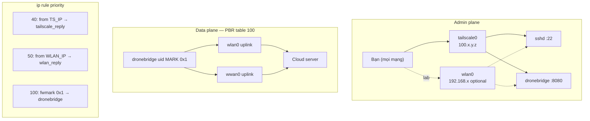

# Network Architecture Spec — WiFi + 4G Data Pipe, Tailscale Admin Plane

> **Trạng thái:** Phác thảo (chưa implement)  
> **Phiên bản:** 1.0  
> **Ngày:** 2026-07-01  
> **Phạm vi:** Bỏ ETH khỏi **ống uplink drone**; chỉ **WiFi** và **4G**. Quản trị (SSH + dashboard `:8080`) qua **Tailscale**, tùy chọn LAN WiFi.

---

## 1. Mục tiêu

| Mục tiêu | Mô tả |
|----------|--------|
| **Data plane** | DroneBridge (MAVLink, auth TCP, WireGuard, camera RTSP) uplink qua **WiFi hoặc 4G** theo policy — không ảnh hưởng admin |
| **Admin plane** | SSH + `http://<tailscale-ip>:8080/dashboard.html` **ổn định**, không phụ thuộc ống WiFi/4G đang active |
| **Admin LAN (tùy chọn)** | Cùng phòng lab: `http://<wlan-ip>:8080` — rule reply riêng |
| **Không dùng ETH cho uplink** | `eth0` (Pixhawk LAN) vẫn có thể tồn tại cho MAVLink local; **không** tham gia PBR chọn uplink cloud |

---

## 2. Hai mặt phẳng (planes)

```
┌──────────────────────────────────────────────────────────────────┐
│ ADMIN PLANE — không phụ thuộc ống drone                          │
│                                                                  │
│   tailscale0 (100.x.y.z)  ← PRIMARY (SSH, :8080 từ mọi nơi)     │
│   wlan0      (192.168.x)  ← OPTIONAL (cùng LAN lab)              │
│                                                                  │
│   Không dùng wwan0 cho reply admin                               │
└──────────────────────────────────────────────────────────────────┘

┌──────────────────────────────────────────────────────────────────┐
│ DATA PLANE — DroneBridge app only                                │
│                                                                  │
│   PBR table 100 + iptables MARK uid → chọn WiFi hoặc 4G         │
│                                                                  │
│   wlan0  ──┐                                                     │
│            ├── policy (connection_config priority)               │
│   wwan0  ──┘                                                     │
└──────────────────────────────────────────────────────────────────┘
```

**Nguyên tắc vàng:** Packet có `fwmark 0x1` (uid dronebridge) → table 100. Mọi packet khác (sshd, tailscaled, curl apt) → **không** mark → admin rules / main table.

---

## 3. Routing tables (`/etc/iproute2/rt_tables`)

| ID | Tên | Vai trò |
|----|-----|---------|
| **100** | `dronebridge` | Default route cho traffic DroneBridge (WiFi hoặc 4G) |
| **101** | `wlan_reply` | Reply từ source IP `wlan0` → luôn ra `wlan0` |
| **102** | `tailscale_reply` | Reply từ source IP `tailscale0` → luôn ra `tailscale0` |
| main | (kernel) | Default hệ thống; ưu tiên WiFi metric thấp; **không** default qua `wwan0` |

**Không thêm table cho ETH uplink.**

Ví dụ `/etc/iproute2/rt_tables` (append):

```
100   dronebridge
101   wlan_reply
102   tailscale_reply
```

---

## 4. `ip rule` — thứ tự ưu tiên (priority)

Số **nhỏ hơn** = match **trước**.

| Priority | Rule | Lookup table | Áp dụng cho |
|----------|------|--------------|-------------|
| 0 | `from all lookup local` | local | (kernel mặc định) |
| **40** | `from <TS_IP>/32 lookup tailscale_reply` | 102 | Reply SSH/HTTP **source = Tailscale IP** |
| **50** | `from <WLAN_IP>/32 lookup wlan_reply` | 101 | Reply SSH/HTTP **source = WiFi IP** (lab) |
| **100** | `fwmark 0x1/0x1 lookup dronebridge` | 100 | Chỉ DroneBridge (iptables MARK) |
| 32766 | `from all lookup main` | main | Còn lại |
| 32767 | `from all lookup default` | default | (kernel) |

### Nội dung từng table phụ

**Table 102 `tailscale_reply`** (khi `tailscale0` UP):

```
default dev tailscale0
```

**Table 101 `wlan_reply`** (khi `wlan0` có IP + gateway):

```
default via <wifi_gw> dev wlan0
```

**Table 100 `dronebridge`** (do netmon cập nhật mỗi 30s):

```
# Khi 4G active (priority=4g hoặc WiFi down):
default dev wwan0
# hoặc
default via <wwan_gw> dev wwan0

# Khi WiFi active (priority=wifi hoặc fallback):
default via <wifi_gw> dev wlan0
```

**Main table** (netmon duy trì):

```
default via <wifi_gw> dev wlan0 metric 100    ← admin + hệ thống
# KHÔNG có: default dev wwan0
```

---

## 5. iptables mangle (OUTPUT)

Chỉ mark process DroneBridge:

```
iptables -t mangle -A OUTPUT -m owner --uid-owner <DRONEBRIDGE_USER> -j MARK --set-mark 0x1
# Docker: thêm uid root nếu container chạy root
```

**Không mark:** sshd, tailscaled, systemd, python netmon, enable_4g_auto.

---

## 6. sysctl

| Key | Giá trị | Lý do |
|-----|---------|--------|
| `net.ipv4.conf.wlan0.rp_filter` | `1` (loose) | Tránh drop reply LAN khi route đổi |
| `net.ipv4.conf.tailscale0.rp_filter` | `1` | Tương tự cho admin Tailscale |
| `net.ipv4.conf.all.rp_filter` | `0` hoặc `2` | Giữ mặc định Pi; chỉ override per-if |

File đề xuất: `/etc/sysctl.d/99-dronebridge-admin.conf`

---

## 7. Tailscale cấu hình

### 7.1 Cài đặt

- Package: `tailscale` + `tailscaled`
- Service: `tailscaled.service` (upstream)

### 7.2 Flags khuyến nghị (`/etc/default/tailscaled` hoặc `tailscale up`)

```bash
tailscale up \
  --accept-routes=false \
  --accept-dns=true \
  --ssh=false
```

| Flag | Lý do |
|------|--------|
| `--accept-routes=false` | Tránh Tailscale/other nodes đè **default route** main table → không phá PBR |
| `--accept-dns=true` | MagicDNS (tùy tailnet) |
| `--ssh=false` | Dùng sshd hệ thống trên `:22`, không tailscale ssh wrapper |

### 7.3 Admin URLs

| Kênh | URL / lệnh |
|------|------------|
| **Primary (mọi nơi)** | `ssh user@100.x.y.z` |
| **Primary dashboard** | `http://100.x.y.z:8080/dashboard.html` |
| **LAN lab (optional)** | `http://192.168.21.72:8080/dashboard.html` |

Web server Go bind `0.0.0.0:8080` — **không đổi code**; routing lo reply đúng interface.

---

## 8. Data plane — WiFi vs 4G (không ETH)

Policy đọc từ `/opt/dronebridge/data/connection_config.json`:

```json
{ "priority": "wifi" | "4g" }
```

| `priority` | Table 100 default | Ghi chú |
|------------|-------------------|---------|
| `wifi` | `wlan0` nếu ping OK; else `wwan0` | Lab / nhà |
| `4g` | `wwan0` nếu probe OK; fallback `wlan0` nếu không `4g_only` | Hiện trường |

**`eth0`:** Chỉ MAVLink tới Pixhawk (`10.41.10.x`). Netmon **không** đưa `eth0` vào `choose_pbr_target()`.

---

## 9. Systemd units — sơ đồ phụ thuộc

```
multi-user.target
│
├── tailscaled.service              [NEW — upstream, enable riêng]
│
├── dronebridge-lcd-i2c-setup.service   (oneshot, nhanh)
├── dronebridge-camera-setup.service    (oneshot, nhanh)
│
├── dronebridge-netmon.service          [CRITICAL — admin + PBR]
│     After=network-online.target tailscaled.service
│     Wants=network-online.target tailscaled.service
│     Wants=dronebridge-4g-init.service   ← kích 4G song song, KHÔNG After=
│     ExecStartPre=setup_pbr.sh
│     ExecStart=connection_manager.py
│
├── dronebridge-4g-init.service         [PARALLEL — không Before= netmon]
│     After=network-online.target
│     Type=oneshot, TimeoutStartSec=180
│     ExecStart=enable_4g_auto.py
│     ExecStartPost=connection_manager.py once   [NEW — bảo vệ sau wwan0 UP]
│
└── dronebridge.service
      After=dronebridge-netmon.service
      Wants=dronebridge-netmon.service
      User=cm5drone6425
```

### 9.1 Thay đổi so với hiện tại

| Unit | Hiện tại (repo gốc) | Spec mới |
|------|---------------------|----------|
| `4g-init` | `Before=netmon, dronebridge` → **block 180s** | Bỏ `Before=`; chạy song song |
| `netmon` | `After=4g-init` | `After=network-online + tailscaled`; **không** After 4g-init |
| `4g-init` | — | `ExecStartPost=connection_manager once` sau wwan0 |
| `drone-stack.target` | Gom tất cả | Giữ; bỏ phụ thuộc tuần tự 4g→netmon |

### 9.2 Boot timeline mục tiêu

```
T+0s    kernel, NetworkManager
T+3s    sshd listen :22
T+5s    tailscaled → tailscale0 (nếu đã login)
T+8s    netmon start
          setup_pbr.sh (mark, tables)
          wait wlan IP + TS IP (retry ≤60s)   [NEW]
          ensure_admin_routes()
          loop 30s
T+8s    4g-init start (song song)
T+30–120s  4g-init xong → wwan0 UP → ExecStartPost once
T+10s   dronebridge start (sau netmon active)
```

**Không** block `multi-user.target` chờ 4g-init → tránh hardware watchdog 60s reboot.

---

## 10. `connection_manager.py` — thay đổi logic (spec)

### 10.1 Hàm mới / đổi tên

| Hàm | Việc làm |
|-----|----------|
| `wait_for_iface_ip(iface, timeout=60)` | Poll đến khi có IPv4 (fix race WiFi DHCP) |
| `ensure_tailscale_source_reply(ts_ip)` | Rule prio 40 + table 102 |
| `ensure_wifi_source_reply(wlan_ip, gw)` | Giữ như hiện tại (prio 50) |
| `ensure_admin_routes()` | Gọi TS + WiFi reply; **không phụ thuộc** PBR iface |
| `ensure_system_wifi_route()` | Đổi tên thành phần của `ensure_admin_routes()` + `remove_main_default_via_wwan()` |

### 10.2 Vòng lặp chính (mỗi 30s)

```
1. ensure_admin_routes()      ← luôn chạy trước
2. verify_pbr_rule()
3. choose_pbr_target()        ← chỉ wlan0 | wwan0
4. set_pbr_route()
5. maybe_reinit_4g()
6. _save_status()             ← thêm tailscale block trong JSON
```

### 10.3 `network_status.json` — trường mới

```json
{
  "admin": {
    "tailscale": { "ip": "100.x.y.z", "online": true, "reply_rule": "ok" },
    "wifi":      { "ip": "192.168.21.72", "reply_rule": "ok" }
  },
  "data_pipe": {
    "active_interface": "wwan0",
    "priority": "4g"
  }
}
```

---

## 11. `setup_pbr.sh` — thay đổi

1. Đăng ký table **102** `tailscale_reply`
2. `sysctl` rp_filter cho `tailscale0`
3. Gọi `connection_manager.py once` **sau** retry WiFi/TS IP (script wrapper hoặc logic trong Python)
4. Exit non-zero nếu **không** có ít nhất **một** admin path OK (TS hoặc wlan)

---

## 12. Ma trận kiểm tra (acceptance)

| # | Kịch bản | Kỳ vọng |
|---|----------|---------|
| 1 | Boot xong, chỉ WiFi, chưa 4G | SSH qua TS OK; dashboard TS OK; PBR table 100 → wlan0 |
| 2 | 4g-init xong, wwan0 UP | SSH/dashboard TS **vẫn OK**; PBR → wwan0; main **không** default wwan0 |
| 3 | priority=4g, WiFi UP | Admin TS OK; data qua 4G |
| 4 | priority=wifi, 4G UP | Admin TS OK; data qua WiFi |
| 5 | wwan0 flap / 4g reinit | Admin TS không ngắt > 1s |
| 6 | LAN lab | `http://wlan-ip:8080` OK khi có wlan_reply rule |
| 7 | `curl` từ Pi qua TS IP | Response qua tailscale0 (tcpdump) |

---

## 13. Ngoài phạm vi (phase 2)

- ETH uplink / multi-WAN balance
- Tailscale subnet router (advertise LAN)
- Firewall nftables cho :8080 chỉ tailscale + LAN
- SELinux / fail2ban

---

## 14. Thứ tự implement (khi bắt đầu code)

1. `rt_tables` + constants table 102 trong `connection_manager.py`
2. `ensure_tailscale_source_reply()` + `wait_for_iface_ip()` + retry trong `once`
3. Cập nhật `setup_pbr.sh` + `ensure_admin_routes()`
4. Sửa systemd units (§9)
5. `ExecStartPost` trên 4g-init
6. Cài Tailscale + doc join tailnet
7. Test matrix §12 trên Pi thật (**từng bước, user xác nhận trước khi enable**)

---

## 15. Sơ đồ tổng thể



---

## 17. Fleet — tên drone (dashboard)

Mỗi CM5 có **tên hiển thị** độc lập UUID server auth:

| Nguồn | File | Ghi chú |
|-------|------|---------|
| Mặc định (deploy) | `config.yaml` → `device.name` | VD: `Drone_sim_1455` |
| Runtime (dashboard) | `data/device_profile.json` | Ghi đè khi lưu từ **Cài đặt → Tên drone** |

**API:** `GET/POST /api/device/profile` — trả về `{ name, uuid, hostname }`.

**Hiển thị:** sidebar dashboard, `document.title`, `/api/status` → `drone_name`.

**Fleet 10 máy:** đặt tên khác nhau (`Drone_sim_1455`, `Drone_field_02`, …); truy cập qua Tailscale hostname hoặc bookmark `http://<ts-host>:8080/dashboard.html`. Tên dashboard giúp xác nhận đúng máy sau khi mở tab.

---

## 16. Tham chiếu code hiện tại

| File | Vai trò |
|------|---------|
| `Module_4G/connection_manager.py` | Netmon + PBR + wlan_reply (mở rộng TS) |
| `Module_4G/enable_4g_auto.py` | 4G init; thêm post-hook admin |
| `etc/systemd/setup_pbr.sh` | Mark + tables |
| `etc/systemd/dronebridge-netmon.service` | Daemon routing |
| `etc/systemd/dronebridge-4g-init.service` | Modem oneshot |
| `web/server.go` | Listen `0.0.0.0:8080` — giữ nguyên |
| `web/device_profile.go` | Tên drone + `/api/device/profile` |
