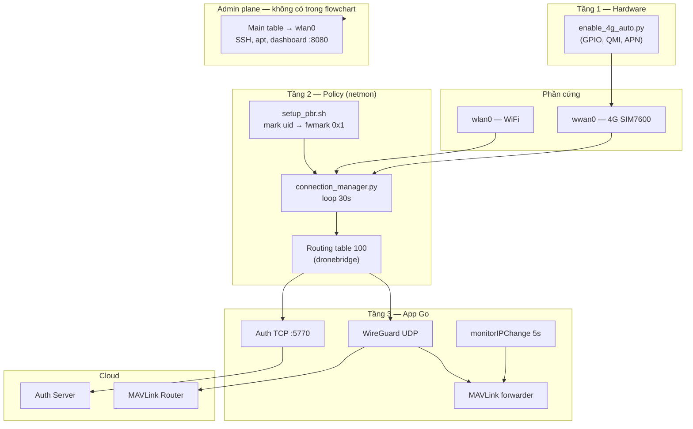
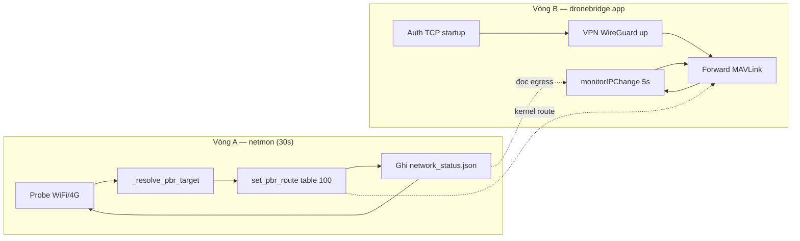

# So sánh Sơ đồ Logic vs Kiến trúc Mạng Thực tế

> **Phiên bản:** 1.0  
> **Cập nhật:** 2026-07-02  
> **Mục đích:** Đối chiếu flowchart ý tưởng (WiFi/4G → ưu tiên → đăng ký → kiểm tra → đẩy data) với code và systemd đang chạy trên Pi CM5.

**Tài liệu liên quan:**

- [NETWORK_ARCHITECTURE.md](./NETWORK_ARCHITECTURE.md) — kiến trúc mạng đang triển khai
- [SYSTEM_ARCHITECTURE.md](./SYSTEM_ARCHITECTURE.md) — kiến trúc 3 tầng + logic failover chi tiết
- [STARTUP_FLOW.md](./STARTUP_FLOW.md) — thứ tự khởi động Auth → VPN → MAVLink

---

## 1. Sơ đồ ý tưởng (flowchart)

Flowchart mô tả logic đơn giản:

```
┌─────────┐   ┌─────────┐
│  WIFI   │   │   4G    │
└────┬────┘   └────┬────┘
     └──────┬──────┘
            ▼
   ┌────────────────────────────┐
   │ Chọn ưu tiên 1 trong 2    │
   │ (nếu cùng kết nối 1 lúc)   │
   └─────────────┬──────────────┘
                 ▼
   ┌────────────────────────────┐
   │ Đăng ký đẩy dữ liệu lên    │
   │ server                     │
   └─────────────┬──────────────┘
                 ▼
   ┌────────────────────────────┐     NO (quay lại chọn ưu tiên)
   │ Kiểm tra đang là mạng      │◄────────────────────────────┐
   │ ưu tiên chưa?              │                             │
   └─────────────┬──────────────┘                             │
                 │ YES                                          │
                 ▼                                              │
   ┌────────────────────────────┐                             │
   │ Đẩy data lên server        │─────────────────────────────┘
   └────────────────────────────┘     (lặp: kiểm tra lại ưu tiên)
```

**Ý tưởng cốt lõi:** ưu tiên một trong hai mạng, đăng ký uplink, liên tục xác nhận vẫn đúng mạng ưu tiên rồi mới/chỉ khi đó mới đẩy data.

---

## 2. Kết luận nhanh

| Tiêu chí | Đánh giá |
|----------|----------|
| **Giống flowchart** | ~70% về ý tưởng (ưu tiên + monitor + đẩy data) |
| **Phức tạp hơn flowchart** | Có — thêm PBR kernel, tách admin/data, auth ≠ VPN, reinit modem |
| **Lộn xộn / spaghetti** | **Không** — tách 3 tầng systemd, có tài liệu và file rõ vai trò |
| **Điểm dễ nhầm** | Flowchart gộp 1 vòng lặp app; thực tế là **2 vòng lặp song song** (netmon 30s + forwarder 5s) |

**Tóm lại:** Flowchart là **mô hình logic đúng hướng**. Code **triển khai đúng ý đó** nhưng ở tầng **OS routing (Policy-Based Routing)** thay vì gom hết vào một loop “đẩy data” trong app.

---

## 3. Ánh xạ từng bước flowchart → code thực tế

| Bước trong flowchart | Thực tế trong repo | File / component chính |
|----------------------|-------------------|-------------------------|
| **WIFI** | Interface `wlan0` — OS (NetworkManager/DHCP) cấp IP | Không có script WiFi riêng trong repo |
| **4G** | Interface `wwan0` — modem SIM7600 qua QMI | `Module_4G/enable_4g_auto.py` |
| **Chọn ưu tiên 1 trong 2** | `_resolve_pbr_target()` theo `config.yaml` → `network.mode` | `Module_4G/connection_manager.py` |
| **Đăng ký đẩy dữ liệu lên server** | Auth TCP một lần lúc startup (có retry nền) | `auth/client.go`, `main.go` |
| **Kiểm tra đang là mạng ưu tiên chưa?** | Netmon probe mỗi **30s** + forwarder monitor egress mỗi **5s** | `connection_manager.py`, `forwarder/forwarder.go` |
| **Đẩy data lên server** | MAVLink + camera qua WireGuard UDP; kernel route theo table 100 | `forwarder/forwarder.go`, `vpn/` |

### 3.1 Khác biệt quan trọng so với flowchart

1. **Chọn mạng không nằm trong app Go** — `connection_manager.py` cập nhật routing table 100; Go chỉ đọc `/run/dronebridge/network_status.json` và phục hồi session khi egress đổi.
2. **“Đăng ký” không lặp mỗi gói MAVLink** — Auth TCP (`:5770`) chạy lúc khởi động; MAVLink forward liên tục sau khi VPN up.
3. **“Kiểm tra ưu tiên” không chặn từng packet** — Kernel PBR quyết định đường đi; netmon đổi default route table 100 định kỳ.
4. **Admin plane tách biệt** — SSH, apt, dashboard không đi theo logic ưu tiên data plane (main table luôn ưu tiên WiFi).

---

## 4. Kiến trúc thực tế — 3 tầng systemd

```
multi-user.target
│
├── dronebridge-4g-init.service     [Tầng 1 — Hardware]
│     enable_4g_auto.py             GPIO → QMI → wwan0 IP
│     ExecStartPost: connection_manager.py once
│
├── dronebridge-netmon.service      [Tầng 2 — Policy]
│     ExecStartPre: setup_pbr.sh      ip rule + iptables mark
│     connection_manager.py           loop 30s: probe + PBR table 100
│
└── dronebridge.service             [Tầng 3 — Application]
      dronebridge binary              auth → VPN → MAVLink forward
```

### Sơ đồ tổng thể (Mermaid)



---

## 5. Hai mặt phẳng routing (điểm flowchart không thể hiện)

```
┌─────────────────────────────────────────────────────────────────┐
│  ADMIN / SYSTEM (main table)                                    │
│    sshd, apt, tailscaled, python netmon, enable_4g_auto         │
│    default → wlan0 (metric thấp)                                │
│    KHÔNG default qua wwan0                                    │
└─────────────────────────────────────────────────────────────────┘

┌─────────────────────────────────────────────────────────────────┐
│  DATA PLANE (table 100 — dronebridge)                           │
│    dronebridge process (uid mark 0x1)                           │
│    default → wwan0 khi 4G probe OK                              │
│    default → wlan0 khi fallback (mode ≠ 4g_only)                │
└─────────────────────────────────────────────────────────────────┘
```

| Thành phần | Giá trị | File thiết lập |
|-----------|---------|----------------|
| Routing table | `100` / tên `dronebridge` | `/etc/iproute2/rt_tables` |
| Packet mark | `0x1` | `etc/systemd/setup_pbr.sh` |
| iptables | `uid-owner <user> → MARK 0x1` | `etc/systemd/setup_pbr.sh` |
| ip rule | `fwmark 0x1 lookup 100` | `etc/systemd/setup_pbr.sh` |

**Nguyên tắc:** Chọn interface mạng **không nằm trong code Go**. Go chỉ **phát hiện hậu quả** (IP đổi / socket stale) và **tự phục hồi session**.

---

## 6. Logic chọn WiFi vs 4G (tương đương “chọn ưu tiên”)

**Nguồn cấu hình:** `config.yaml`

```yaml
network:
  mode: prefer_4g   # prefer_4g | 4g_only | wifi_only
  fallback_delay: 300
```

**Hàm quyết định:** `NetworkMonitor._resolve_pbr_target()` trong `Module_4G/connection_manager.py`

### 6.1 Bảng theo `network.mode`

| `network.mode` | Điều kiện | Interface table 100 |
|----------------|-----------|---------------------|
| `wifi_only` | Luôn | `wlan0` |
| `4g_only` | Luôn | `wwan0` (kể cả probe fail) |
| `prefer_4g` | 4G probe OK | `wwan0` |
| `prefer_4g` | 4G fail, chưa hết `fallback_delay` | `wwan0` (chờ phục hồi) |
| `prefer_4g` | 4G fail > `fallback_delay`, WiFi OK | `wlan0` (fallback) |
| `prefer_4g` | Cả hai down | `wwan0` (giữ route 4G) |

### 6.2 Sơ đồ quyết định `prefer_4g`

```
                    ┌─────────────┐
                    │  wwan_ok?   │
                    └──────┬──────┘
                      YES  │  NO
                           │
              ┌────────────┴────────────┐
              ▼                         ▼
        target = wwan0          ghi _4g_down_since
        reset timer                       │
              │              ┌──────────┴──────────┐
              │              ▼                     ▼
              │     elapsed ≤ fallback_delay   elapsed > fallback_delay
              │              │                     │
              │              ▼                     ▼
              │        target = wwan0        wlan_ok?
              │        (chờ phục hồi)              │
              │                           YES      NO
              │                            │       │
              │                            ▼       ▼
              │                      wlan0     wwan0
              └──────────────┬─────────────────┘
                             ▼
                    set_pbr_route(target)
```

### 6.3 Health check 4G (mỗi chu kỳ 30s)

```
wwan_ip = get_iface_ip("wwan0")

IF không có IP:
    wwan_ok = FALSE
ELSE:
    wwan_ping_ok = ping_via("wwan0", 8.8.8.8)
    IF ping OK:
        wwan_ok = TRUE
    ELSE:
        # Một số carrier chặn ICMP
        wwan_tcp_ok = tcp_probe_via_wwan()  # TCP :5770 hoặc 1.1.1.1:443
        wwan_ok = wwan_tcp_ok
```

WiFi: `wlan_ip` có + `ping_via("wlan0")` OK.

### 6.4 Timeline chuyển đổi điển hình

```
T+0s     4G OK        → PBR: wwan0
T+30s    4G mất ping  → vẫn PBR: wwan0 (chờ fallback_delay)
T+330s   4G vẫn down, WiFi OK → PBR: wlan0  ⚠️ fallback
T+360s   4G phục hồi → PBR: wwan0 ngay lập tức ✅
```

Mặc định `fallback_delay = 300` giây (5 phút).

---

## 7. Hai vòng lặp song song (thay cho 1 loop trong flowchart)

Flowchart gộp “kiểm tra ưu tiên” và “đẩy data” vào một vòng. Thực tế tách thành **hai process độc lập**:

### 7.1 Vòng lặp A — Network Monitor (30 giây)

**File:** `Module_4G/connection_manager.py`  
**Service:** `dronebridge-netmon.service`

```python
while True:
    apply_routing_policy()   # probe, chọn iface, set table 100, maybe reinit 4G
    sleep(30)
```

**Tương đương flowchart:** “Chọn ưu tiên” + “Kiểm tra đang là mạng ưu tiên chưa?”

**Output:** `/run/dronebridge/network_status.json`

### 7.2 Vòng lặp B — Application (liên tục + monitor 5 giây)

**File:** `forwarder/forwarder.go`, `main.go`

| Thành phần | Chu kỳ | Vai trò |
|------------|--------|---------|
| `receiveAndForward` | event-driven | Pixhawk → Server (MAVLink) |
| `receiveFromServer` | event-driven | Server → Pixhawk |
| `monitorIPChange` | **5 giây** | Phát hiện egress/IP đổi → rebuild socket + `ForceReconnect` auth |
| Auth retry (nền) | 10 giây (nếu fail) | Đăng ký lại session TCP |

**Tương đương flowchart:** “Đăng ký đẩy data” (auth startup) + “Đẩy data lên server” (forward liên tục) + phản ứng khi mạng đổi.

### 7.3 Sơ đồ 2 vòng lặp



---

## 8. Luồng “đăng ký + đẩy data” (Tầng 3)

Flowchart gộp hai bước này; thực tế là **chuỗi startup có thứ tự cố định**:

```
1. Auth TCP :5770     → AUTH_INIT → CHALLENGE → RESPONSE → ACK
2. VPN provision 0xB0 → cập nhật WG peer endpoint
3. WireGuard UP       → tunnel 10.8.0.x
4. MAVLink forward    → UDP qua tunnel tới cloud
5. monitorIPChange    → khi table 100 đổi iface/IP → rebuild + reconnect
```

| Giao thức | Đường đi | Ghi chú |
|-----------|----------|---------|
| Auth TCP | Public IP, theo PBR table 100 | **Không** qua VPN tunnel |
| WireGuard UDP | Theo PBR table 100 | MAVLink data plane |
| Web :8080 | Bind `0.0.0.0` | Admin; reply theo main table (WiFi) |

Chi tiết: [STARTUP_FLOW.md](./STARTUP_FLOW.md), [auth_session.md](./auth_session.md)

---

## 9. Phục hồi 4G phần cứng (không có trong flowchart)

Khi 4G probe fail liên tục (`FAIL_THRESHOLD = 1`):

```
systemctl restart dronebridge-4g-init.service   # non-blocking
```

| Tình huống | Min retry reinit | Max retry |
|------------|------------------|-----------|
| Bình thường | 5 phút | 60 phút (exponential) |
| Đang fallback WiFi | 1 phút | 2 phút |

**File:** `trigger_4g_reinit()` trong `connection_manager.py`  
**Service:** `dronebridge-4g-init.service` → `enable_4g_auto.py`

---

## 10. Những gì flowchart chưa thể hiện

| Thành phần | Mô tả | Trạng thái |
|------------|-------|------------|
| **Admin plane tách biệt** | SSH/dashboard không theo PBR data | ✅ Đang chạy |
| **PBR kernel-level** | iptables mark + ip rule, không chọn socket trong app | ✅ Đang chạy |
| **Auth TCP ≠ VPN UDP** | Tránh auth kẹt khi tunnel flap | ✅ Đang chạy |
| **Reinit modem 4G** | Phục hồi phần cứng khi link chết | ✅ Đang chạy |
| **Tailscale admin plane** | SSH/dashboard qua `tailscale0` | 📋 Spec — [NETWORK_ARCHITECTURE_SPEC.md](./NETWORK_ARCHITECTURE_SPEC.md) |
| **`connection_config.json` priority** | `wifi` / `4g` runtime JSON | 🧪 Thử nghiệm, chưa merge ổn định |

---

## 11. Bản đồ file tham chiếu

| File | Vai trò | Tầng |
|------|---------|------|
| `Module_4G/enable_4g_auto.py` | Init modem QMI, cấp IP `wwan0` | 1 |
| `Module_4G/vn_carriers.py` | APN/PAP theo nhà mạng VN | 1 |
| `Module_4G/connection_manager.py` | PBR monitor, probe, failover, reinit | 2 |
| `etc/systemd/setup_pbr.sh` | ip rule + iptables mark | 2 |
| `etc/systemd/dronebridge-netmon.service` | Daemon netmon | 2 |
| `etc/systemd/dronebridge-4g-init.service` | Oneshot init 4G | 1 |
| `network/egress.go` | Go đọc `network_status.json` | 3 |
| `network/pbr_dial.go` | Dial TCP với SO_MARK 0x1 | 3 |
| `auth/client.go` | Auth TCP client | 3 |
| `forwarder/forwarder.go` | MAVLink + `monitorIPChange` | 3 |
| `config.yaml` | `network.mode`, `fallback_delay` | Cấu hình |

---

## 12. Lệnh kiểm tra nhanh

```bash
# Trạng thái netmon
sudo python3 /opt/dronebridge/Module_4G/connection_manager.py status

# Chẩn đoán đầy đủ
sudo python3 /opt/dronebridge/Module_4G/connection_manager.py diag

# Áp dụng routing một lần (sau 4g-init)
sudo python3 /opt/dronebridge/Module_4G/connection_manager.py once

# Log realtime
journalctl -u "dronebridge*" -f

# Kiểm tra PBR
ip rule show | grep fwmark
ip route show table dronebridge
iptables -t mangle -L OUTPUT -n -v | grep MARK

# Trạng thái runtime
cat /run/dronebridge/network_status.json
```

---

## 13. Mental model đơn giản (đọc thay flowchart)

Nếu muốn hình dung gọn mà vẫn đúng code:

```
Nhánh A (netmon, root, 30s):
  probe WiFi + 4G → chọn iface theo config → ghi routing table 100 → ghi JSON

Nhánh B (dronebridge app, user pi):
  auth 1 lần → VPN up → forward MAVLink liên tục
  mỗi 5s: đọc egress → nếu đổi → rebuild socket + reconnect auth

Admin (mọi lúc):
  SSH / dashboard qua WiFi (main table) — không bị nhánh A/B kéo sang 4G
```

---

## 14. Câu hỏi thường gặp

### Flowchart có sai không?

Không — đúng **ý tưởng nghiệp vụ**. Chỉ **đơn giản hóa** so với triển khai thực tế (thiếu admin plane, PBR, tách auth/VPN).

### App có tự chọn WiFi hay 4G trước mỗi gói tin không?

**Không.** Kernel tra table 100 theo fwmark. Netmon cập nhật default route trong table đó mỗi 30 giây.

### Khi chuyển WiFi ↔ 4G, MAVLink có tự phục hồi không?

**Có.** `monitorIPChange` (5s) phát hiện egress/IP đổi → rebuild UDP sender + `ForceReconnect` auth.

### `prefer_4g` có ưu tiên 4G khi cả hai cùng sống không?

**Có** — nếu 4G probe OK thì table 100 → `wwan0`, bất kể WiFi có online hay không.

### Kiến trúc có “lộn xộn” không?

**Không** — phức tạp có chủ đích: tách hardware init / routing policy / application để SSH ổn định khi drone bay 4G. Tài liệu: `NETWORK_ARCHITECTURE.md`, `SYSTEM_ARCHITECTURE.md`, tài liệu này.
