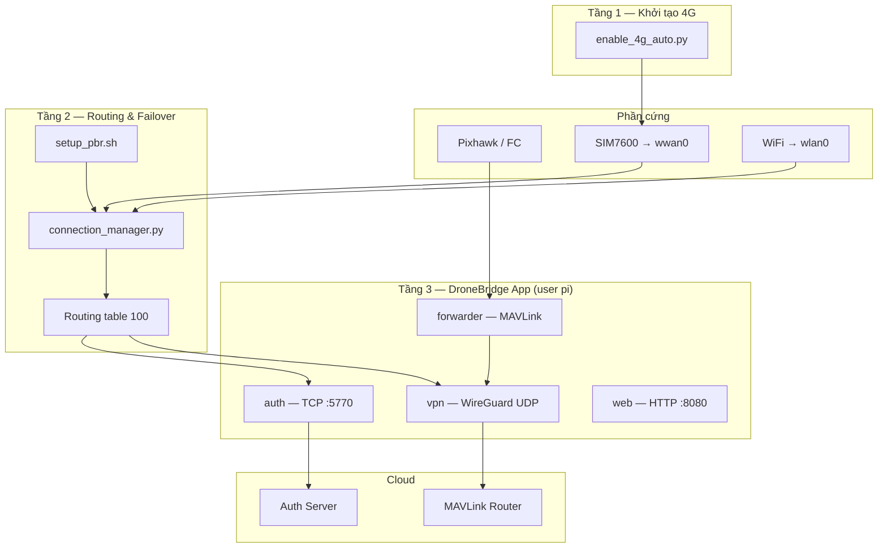

# Kiến trúc Hệ thống — Pi CM5 DroneBridgeService

> **Phiên bản:** 2.0 (Policy-Based Routing)  
> **Cập nhật:** 2026-07-02  
> **Phạm vi:** Kết nối WiFi / 4G, routing, kết nối server, phục hồi session

---

## Mục lục

1. [Mục tiêu thiết kế](#1-mục-tiêu-thiết-kế)
2. [Sơ đồ tổng quan](#2-sơ-đồ-tổng-quan)
3. [Kiến trúc 3 tầng](#3-kiến-trúc-3-tầng)
4. [Policy-Based Routing (PBR)](#4-policy-based-routing-pbr)
5. [Logic chuyển đổi WiFi ↔ 4G](#5-logic-chuyển-đổi-wifi--4g)
6. [Phục hồi phần cứng 4G](#6-phục-hồi-phần-cứng-4g)
7. [Tầng ứng dụng (Go)](#7-tầng-ứng-dụng-go)
8. [Luồng kết nối server](#8-luồng-kết-nối-server)
9. [Hai lớp failover song song](#9-hai-lớp-failover-song-song)
10. [Systemd & thứ tự khởi động](#10-systemd--thứ-tự-khởi-động)
11. [Cấu hình](#11-cấu-hình)
12. [Bản đồ file](#12-bản-đồ-file)
13. [Tài liệu liên quan](#13-tài-liệu-liên-quan)

---

## 1. Mục tiêu thiết kế

Hệ thống giải quyết bài toán: **Drone cần uplink 4G khi bay**, nhưng **SSH qua WiFi phải luôn sống** để vận hành từ xa.

| Yêu cầu | Cách đáp ứng |
|---------|--------------|
| Uplink 4G ưu tiên cho telemetry | PBR table 100 → `wwan0` khi 4G healthy |
| SSH / apt không bị ảnh hưởng | Default route hệ thống (main table) luôn giữ trên `wlan0` |
| Fallback WiFi khi 4G mất lâu | `prefer_4g` + `fallback_delay` |
| IP 4G đổi liên tục (roaming) | App rebuild socket + TCP reconnect + MAVLink session heartbeat |
| Auth ổn định trên mạng không ổn định | TCP auth đi public route (không qua VPN tunnel) |

**Nguyên tắc cốt lõi:** Chọn interface mạng **không nằm trong code Go**. Go chỉ **phát hiện hậu quả** (IP đổi / socket stale) và **tự phục hồi session**.

---

## 2. Sơ đồ tổng quan



### Phân tách traffic

```
┌─────────────────────────────────────────────────────────────────┐
│  TRAFFIC HỆ THỐNG (SSH, apt, ping thường)                      │
│  → Bảng route MAIN                                              │
│  → Default via wlan0                                            │
│  → KHÔNG BAO GIỜ bị connection_manager thay đổi                 │
├─────────────────────────────────────────────────────────────────┤
│  TRAFFIC DRONEBRIDGE (process chạy user pi)                    │
│  → iptables mangle: OUTPUT uid=pi → mark 0x01                   │
│  → ip rule: fwmark 0x01 → lookup table 100 (dronebridge)      │
│  → Default via wwan0 HOẶC wlan0 (do netmon quyết định)        │
└─────────────────────────────────────────────────────────────────┘
```

---

## 3. Kiến trúc 3 tầng

| Tầng | Systemd unit | File chính | User | Chu kỳ |
|------|--------------|------------|------|--------|
| **1 — Hardware Init** | `dronebridge-4g-init.service` | `Module_4G/enable_4g_auto.py` | root | oneshot (boot) |
| **2 — Routing Policy** | `dronebridge-netmon.service` | `Module_4G/connection_manager.py` | root | loop 30s |
| **3 — Application** | `dronebridge.service` | `dronebridge` binary (`main.go`) | `pi` | daemon |

**Thứ tự phụ thuộc:** `4g-init` → `netmon` → `dronebridge`

### Tầng 1 — Khởi tạo 4G

**File:** `Module_4G/enable_4g_auto.py`  
**Mục đích:** Đưa modem SIM7600 online và gán IP cho `wwan0`.

| Bước | Hành động | Kết quả |
|------|-----------|---------|
| 1 | GPIO power-on modem | Modem có nguồn / RF |
| 2 | Unbind `simcom_wwan`, bind `qmi_wwan` | `/dev/cdc-wdm0` |
| 3 | QMI verify (model, SIM, online) | Modem sẵn sàng |
| 4 | AT config (tắt sleep, band LTE, APN) | APN `v-internet` |
| 5 | NAS registration (poll ≤ 120s) | Đăng ký nhà mạng |
| 6 | WDS start network | Session data 4G |
| 7 | `ip addr add` trên `wwan0`, link up | Interface có IP |

**Ràng buộc:** Script **không thêm default route hệ thống** trên `wwan0`.

**WiFi:** Repo không có script kết nối WiFi. Giả định OS (NetworkManager/dhcp) đã cấu hình `wlan0`.

### Tầng 2 — Network Monitor

**File:** `Module_4G/connection_manager.py`  
**Class:** `NetworkMonitor`

```
WHILE True:
    apply_routing_policy()
    sleep(30)   # MONITOR_INTERVAL_S
```

**Output runtime:** `/run/dronebridge/network_status.json`

### Tầng 3 — Application

**File:** `main.go` + các package `auth/`, `forwarder/`, `vpn/`, `web/`

Bridge MAVLink Pixhawk ↔ Cloud qua WireGuard; duy trì session auth TCP.

Chi tiết startup: [STARTUP_FLOW.md](./STARTUP_FLOW.md)

---

## 4. Policy-Based Routing (PBR)

### 4.1 Thiết lập ban đầu

**File:** `etc/systemd/setup_pbr.sh`  
**Chạy bởi:** `dronebridge-netmon.service` → `ExecStartPre`

| Thành phần | Giá trị | Ý nghĩa |
|-----------|---------|---------|
| Routing table | `100` / tên `dronebridge` | Bảng route riêng cho app |
| Packet mark | `0x01` | Nhãn gắn lên packet OUTPUT |
| iptables rule | `uid-owner pi → MARK 0x01` | Traffic user `pi` bị đánh dấu |
| ip rule | `fwmark 0x1 lookup 100` | Packet có mark → tra table 100 |

### 4.2 Cập nhật route PBR

**Hàm:** `NetworkMonitor.set_pbr_route(iface, gateway=None)`

```
1. ip route flush table 100
2. IF gateway có giá trị:
       ip route add default via gateway dev iface table 100
   ELSE:
       ip route add default dev iface table 100
```

**Hàm bảo vệ:** `ensure_system_wifi_route()` — đảm bảo main table default route vẫn trỏ `wlan0` (phục vụ SSH).

---

## 5. Logic chuyển đổi WiFi ↔ 4G

### 5.1 Health check (mỗi 30 giây)

**Hàm:** `NetworkMonitor.apply_routing_policy()`

#### Kiểm tra 4G (`wwan0`)

```
wwan_ip = get_iface_ip("wwan0")

IF wwan_ip IS EMPTY:
    wwan_ok = FALSE
ELSE:
    wwan_ping_ok = ping_via("wwan0", 8.8.8.8)

    IF wwan_ping_ok:
        wwan_ok = TRUE
        probe_mode = "PING_OK"
    ELSE:
        # Một số mạng 4G chặn ICMP
        wwan_tcp_ok = tcp_probe_via_wwan(wwan_ip)
        # TCP connect tới auth server :5770 (fallback 1.1.1.1:443)
        wwan_ok = wwan_tcp_ok
        probe_mode = "TCP_OK" hoặc "FAIL"
```

#### Kiểm tra WiFi (`wlan0`)

```
wlan_ip = get_iface_ip("wlan0")
wlan_ok = (wlan_ip NOT EMPTY) AND ping_via("wlan0", 8.8.8.8)
```

### 5.2 Chọn interface đích

**Nguồn cấu hình:** `config.yaml` → `network.mode`, `network.fallback_delay`

| `network.mode` | Điều kiện | `target_iface` |
|----------------|-----------|----------------|
| `4g_only` | Luôn luôn | `wwan0` |
| `wifi_only` | Luôn luôn | `wlan0` |
| `prefer_4g` | `wwan_ok == TRUE` | `wwan0` |
| `prefer_4g` | `wwan_ok == FALSE` AND `elapsed_down <= fallback_delay` | `wwan0` (chờ, chưa fallback) |
| `prefer_4g` | `wwan_ok == FALSE` AND `elapsed_down > fallback_delay` AND `wlan_ok == TRUE` | `wlan0` |
| `prefer_4g` | `wwan_ok == FALSE` AND WiFi cũng down | `wwan0` (giữ route 4G dù down) |

**Biến trạng thái:**

| Biến | Ý nghĩa |
|------|---------|
| `_4g_down_since` | Timestamp lần đầu 4G fail; reset về 0 khi 4G OK |
| `_4g_failures` | Số chu kỳ liên tiếp 4G fail; dùng trigger reinit |
| `_wwan_probe_mode` | `PING_OK` / `TCP_OK` / `FAIL` |

### 5.3 Sơ đồ quyết định `prefer_4g`

```
                    ┌─────────────┐
                    │  wwan_ok?   │
                    └──────┬──────┘
                      YES  │  NO
                           │
              ┌────────────┴────────────┐
              ▼                         ▼
        target = wwan0          ghi _4g_down_since
        reset _4g_down_since    tính elapsed_down
              │                         │
              │              ┌──────────┴──────────┐
              │              ▼                     ▼
              │     elapsed <= fallback_delay   elapsed > fallback_delay
              │              │                     │
              │              ▼                     ▼
              │        target = wwan0      wlan_ok?
              │        (chờ phục hồi)            │
              │                           YES      NO
              │                            │       │
              │                            ▼       ▼
              │                      target=   target=
              │                      wlan0     wwan0
              └──────────────┬─────────────────┘
                             ▼
                    set_pbr_route(target_iface)
```

### 5.4 Timeline chuyển đổi điển hình

```
T+0s     4G OK        → PBR: wwan0
T+30s    4G mất ping  → vẫn PBR: wwan0 (chờ fallback_delay)
T+330s   4G vẫn down, WiFi OK → PBR: wlan0  ⚠️ fallback
T+360s   4G phục hồi → PBR: wwan0 ngay lập tức ✅
```

**Mặc định:** `fallback_delay = 300` giây (5 phút).

---

## 6. Phục hồi phần cứng 4G

**Hàm:** `NetworkMonitor.trigger_4g_reinit(wlan_ok=False)`

### Trigger

```
IF wwan_ok == FALSE AND network.mode != "wifi_only":
    _4g_failures += 1

    IF _4g_failures >= FAIL_THRESHOLD:   # FAIL_THRESHOLD = 1
        trigger_4g_reinit()
```

### Hành động

```
systemctl restart dronebridge-4g-init.service   # non-blocking
_reinit_pending = TRUE
```

### Backoff

| Tình huống | Min retry | Max retry |
|------------|-----------|-----------|
| Bình thường | 5 phút | 60 phút (exponential) |
| Đang fallback WiFi | 1 phút | 2 phút |

**Timeout chờ phục hồi sau reinit:** 120 giây (`REINIT_TIMEOUT_S`).

---

## 7. Tầng ứng dụng (Go)

Chọn interface **không** do Go quyết định. Go xử lý **phục hồi sau khi route/IP đổi**.

### 7.1 Auth TCP — `auth/client.go`

| Thuộc tính | Giá trị |
|------------|---------|
| Giao thức | TCP |
| Đích | `auth.host:auth.port` (mặc định `:5770`) |
| Dial | `dialWithLocalIP()` — **không** qua VPN |
| Routing | Theo PBR table 100 (wwan0 hoặc wlan0) |
| Keepalive | `keepaliveLoop()` — SESSION_REFRESH định kỳ |
| Reconnect | `ForceReconnect()` — đóng TCP cũ, dial lại |

### 7.2 VPN — `vpn/manager.go`

| Thuộc tính | Giá trị |
|------------|---------|
| Giao thức | WireGuard userspace |
| Endpoint | `vpn.server_endpoint` (mặc định `:51820`) |
| Data plane | UDP MAVLink → `target_host:target_port` trong tunnel |
| Routing egress | Theo PBR table 100 |

### 7.3 Forwarder — `forwarder/forwarder.go`

| Goroutine | Chu kỳ | Vai trò |
|-----------|--------|---------|
| `receiveAndForward` | event-driven | Pixhawk → Server |
| `receiveFromServer` | event-driven | Server → Pixhawk |
| `sendMavlinkSessionHeartbeat` | theo config | MAVLink ID 42999 — bind session khi IP đổi |
| `monitorIPChange` | **5 giây** | Phát hiện IP đổi/mất → rebuild + reconnect |

### 7.4 Logic `monitorIPChange`

```
MỖI 5 GIÂY:
    currentIP = getCurrentIP()
    # VPN mode: lấy IP assigned từ WireGuard
    # Non-VPN: UDP dial trick lấy local outbound IP

    IF currentIP == "":
        isHealthy = FALSE
        networkWasDown = TRUE
        RETURN

    IF networkWasDown == TRUE:
        # Mạng vừa hồi — rebuild dù IP có thể giống cũ (socket stale)
        rebuildSender("network-restored")
        authClient.ForceReconnect()
        RETURN

    IF previousIP == "":
        rebuildSender("initial-bind")
        RETURN

    IF currentIP != previousIP:
        # Roaming 4G hoặc chuyển WiFi ↔ 4G
        rebuildSender("ip-changed")
        authClient.ForceReconnect()
        RETURN

    IF isHealthy == FALSE:
        rebuildSender("unhealthy-recovery")
```

**Hàm `rebuildSender`:**

1. Đóng `senderNode` cũ  
2. Tạo `senderNode` mới (bind WireGuard UDP)  
3. Gọi `authClient.ForceReconnect()`  
4. Set `isHealthy = TRUE`

---

## 8. Luồng kết nối server

### 8.1 Ba kênh tới cloud

| Kênh | Giao thức | Port | Interface thực tế | Mục đích |
|------|-----------|------|-----------------|----------|
| Auth / session | TCP | 5770 | PBR → wwan0/wlan0 | Đăng ký, xác thực, refresh session |
| WireGuard tunnel | UDP | 51820 | PBR → wwan0/wlan0 | Encapsulate MAVLink |
| MAVLink data | UDP (trong tunnel) | 14550 | logical `10.8.0.1` | Telemetry / command |

**Không có MQTT hay WebSocket** trong codebase.

### 8.2 End-to-end khi dùng 4G

```
Pixhawk (serial/UDP :14540)
    │
    ▼
forwarder.receiveAndForward()
    │
    ▼
WireGuard UDP socket
    │
    ▼
PBR table 100 → wwan0
    │
    ▼
Internet → Cloud Auth (:5770) + Cloud MAVLink Router
```

### 8.3 Session khi IP 4G đổi

1. **PBR** có thể vẫn trên `wwan0` nhưng IP public đổi (roaming)  
2. **`monitorIPChange`** detect → rebuild UDP + `ForceReconnect()` TCP  
3. **MAVLink ID 42999** (session heartbeat) cập nhật binding phía server  
4. **`keepaliveLoop`** refresh session token qua TCP  

Chi tiết protocol: [auth_session.md](./auth_session.md)

---

## 9. Hai lớp failover song song

Hai cơ chế **bổ sung**, không thay thế nhau:

| Lớp | Thành phần | Chu kỳ | Trigger | Hành động |
|-----|------------|--------|---------|-----------|
| **OS / PBR** | `connection_manager.py` | 30s | 4G ping/TCP fail; elapsed > fallback_delay | Đổi routing table 100 |
| **OS / Modem** | `trigger_4g_reinit()` | khi 4G fail | `_4g_failures >= 1` | Restart `dronebridge-4g-init` |
| **App** | `monitorIPChange()` | 5s | IP mất / đổi / network restore | Rebuild UDP + TCP reconnect |

```
         4G mất tín hiệu
                │
    ┌───────────┴───────────┐
    ▼                       ▼
connection_manager      monitorIPChange
(đổi route sau          (rebuild socket
 fallback_delay)         khi IP đổi)
    │                       │
    └───────────┬───────────┘
                ▼
        Server session phục hồi
```

---

## 10. Systemd & thứ tự khởi động

```
Pi Boot
    │
    ├─ dronebridge-4g-init.service     (Type=oneshot, root)
    │       └─ enable_4g_auto.py       → wwan0 UP + IP
    │
    ├─ dronebridge-netmon.service      (After=4g-init, root)
    │       ├─ ExecStartPre: setup_pbr.sh
    │       └─ connection_manager.py   → loop PBR
    │
    └─ dronebridge.service             (After=netmon, User=pi)
            └─ dronebridge binary      → MAVLink + Auth + VPN + Web
```

| Service | File unit |
|---------|-----------|
| 4G init | `etc/systemd/dronebridge-4g-init.service` |
| Netmon | `etc/systemd/dronebridge-netmon.service` |
| App | `etc/systemd/dronebridge.service` |

---

## 11. Cấu hình

### 11.1 `config.yaml` — network mode

```yaml
network:
  mode: prefer_4g          # 4g_only | wifi_only | prefer_4g
  fallback_delay: 300      # giây chờ trước WiFi fallback

auth:
  host: 45.117.171.237
  port: 5770
  keepalive_interval: 30
  session_heartbeat_frequency: 1.0   # Hz — MAVLink 42999

vpn:
  enabled: true
  server_endpoint: "45.117.171.237:51820"
  config_file: vpn_config.json

network:
  target_host: 10.8.0.1     # MAVLink trong tunnel
  target_port: 14550
```

### 11.2 Biến môi trường (`connection_manager.py`)

| Biến | Mặc định | Mục đích |
|------|----------|----------|
| `DRONEBRIDGE_CONFIG` | `/opt/dronebridge/config.yaml` | Nguồn `network.mode` |
| `DRONEBRIDGE_HEALTH_TCP_HOST` | auth host | TCP health probe 4G |
| `DRONEBRIDGE_HEALTH_TCP_PORT` | `5770` | TCP health probe 4G |
| `DRONEBRIDGE_WG_PORT` | `51820` | Counter băng thông UDP |
| `DRONEBRIDGE_REINIT_RETRY_MIN_WIFI` | `1` | Phút — retry reinit khi fallback WiFi |

### 11.3 Runtime status

| File | Writer | Reader |
|------|--------|--------|
| `/run/dronebridge/network_status.json` | `connection_manager.py` | (runtime thực tế) |
| `data/connection_status.json` | — | Web API `/api/network/status` (sample/legacy) |

---

## 12. Bản đồ file

```
Pi_CM5_DroneBridgeService/
├── main.go                          # Entry point app
├── config.yaml                      # Cấu hình chính
├── auth/client.go                   # TCP auth, reconnect
├── forwarder/forwarder.go           # MAVLink bridge, monitorIPChange
├── vpn/manager.go                   # WireGuard tunnel
├── web/server.go                    # HTTP API + UI
├── Module_4G/
│   ├── enable_4g_auto.py            # Tầng 1: khởi tạo 4G
│   ├── connection_manager.py        # Tầng 2: PBR + failover
│   └── set_4g_mode.py               # AT+CNMP band mode
├── etc/systemd/
│   ├── setup_pbr.sh                 # Thiết lập ip rule + iptables
│   ├── dronebridge-4g-init.service
│   ├── dronebridge-netmon.service
│   └── dronebridge.service
└── docs/
    ├── SYSTEM_ARCHITECTURE.md       # ← tài liệu này
    ├── NETWORK_MANAGEMENT.md        # Hướng dẫn vận hành
    ├── STARTUP_FLOW.md              # Startup app Go
    └── auth_session.md              # Protocol auth/session
```

---

## 13. Tài liệu liên quan

| Tài liệu | Nội dung |
|----------|----------|
| [NETWORK_FLOWCHART_COMPARISON.md](./NETWORK_FLOWCHART_COMPARISON.md) | So sánh flowchart ý tưởng vs kiến trúc thực tế (2 vòng lặp, PBR, admin plane) |
| [NETWORK_MANAGEMENT.md](./NETWORK_MANAGEMENT.md) | Deploy, vận hành hằng ngày, Makefile |
| [STARTUP_FLOW.md](./STARTUP_FLOW.md) | Startup `main.go`, goroutines, VPN decision tree |
| [auth_session.md](./auth_session.md) | Registration, authentication, session refresh |

### Ghi chú bảo trì

- Web UI (`connect.html`) vẫn gọi API legacy `/api/network/priority`, `/api/network/switch` trỏ tới CLI `connection_manager.py priority|once` — **CLI này không còn trong v2.0**. Chế độ thực tế điều khiển qua `config.yaml` → `network.mode`.
- Dashboard (`/api/status`) kỳ vọng `network_type` / `network_speed` nhưng backend chưa populate — UI có thể hiển thị "Unknown".
