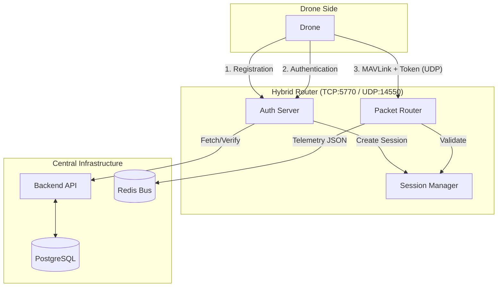
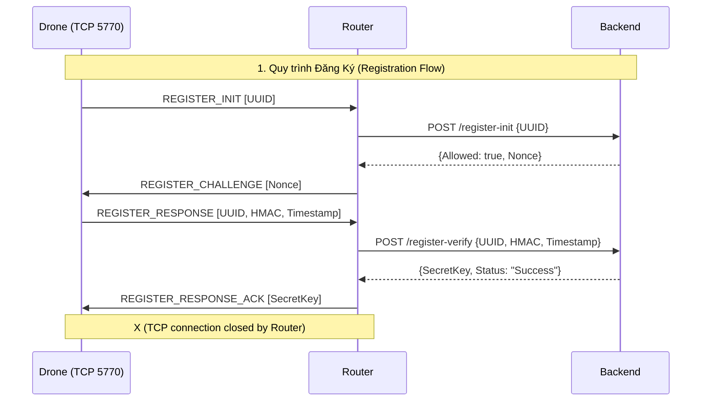
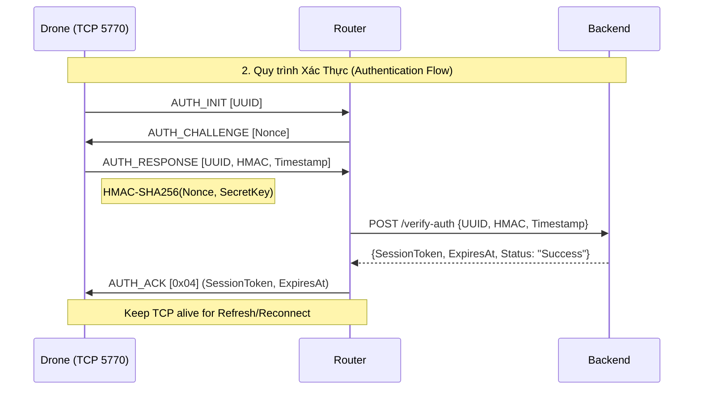
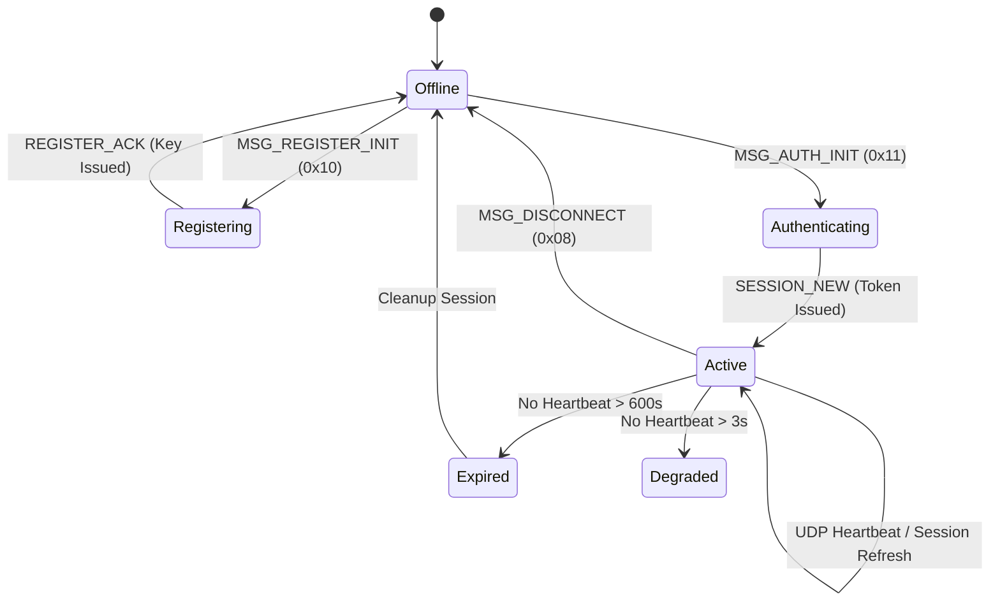
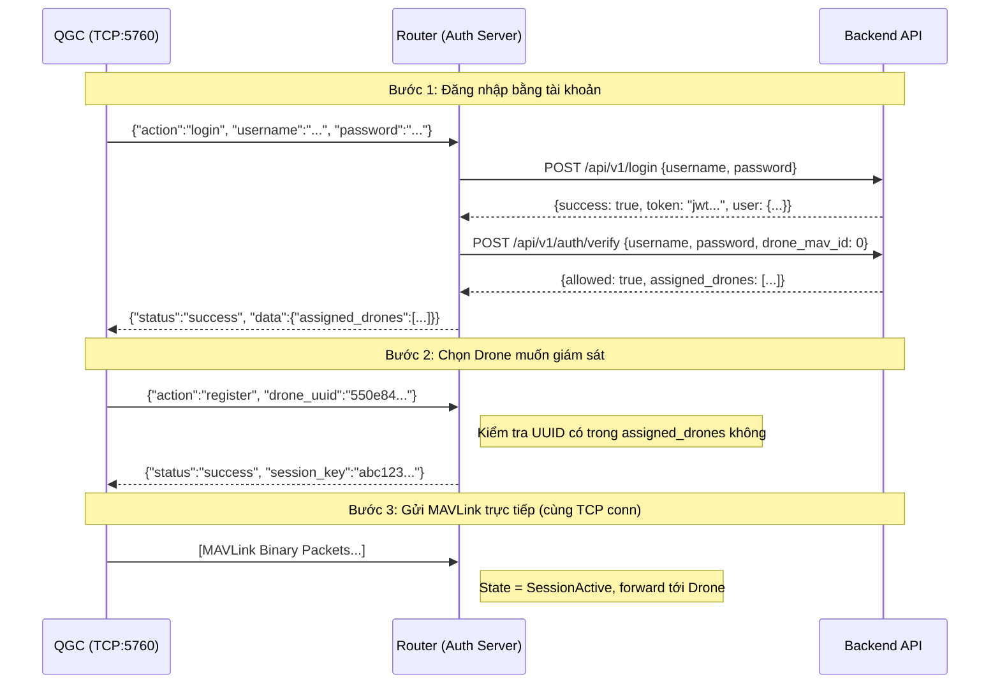

# Authentication & Session Management

**Module chịu trách nhiệm**: `internal/auth/` (Hybrid Router)
- `drone_auth_server.go`: Server TCP chính
- `drone_session_manager.go`: Quản lý phiên làm việc
- `drone_auth.go`: Protocol parsing
- `drone_auth_hmac.go`: HMAC verification

## Tổng Quan

Hệ thống xác thực Drone được chia làm **2 giai đoạn** rõ ràng:
1. **Registration (Đăng ký)**: Một lần duy nhất, Drone nhận `secret_key` từ Backend.
2. **Authentication (Xác thực)**: Mỗi lần kết nối, Drone ký HMAC để nhận `session_token`.

**Cơ chế cập nhật**: 
- `secret_key` chỉ thay đổi khi:
 - Drone thực hiện lại quy trình đăng ký (Registration) từ đầu.
 - Backend chủ động yêu cầu đổi key (Rotation) thông qua trường new_secret_key trong phản hồi xác thực (Auth V2).
- `session_token` được cấp mới mỗi khi Drone thực hiện Authentication thành công.Sau đó Drone sử dụng `session_token` để gửi MAVLink packets qua UDP.
`session_token` có thời hạn ngắn (thường từ 10 phút đến 1 ngày).Drone phải chủ động gửi gói tin MSG_REFRESH_REQUEST (0x04) hoặc MSG_SESSION_REFRESH (0x12) qua kết nối TCP 5770 để gia hạn(thường là cộng thêm 30-60 phút tùy cấu hình) và server trả về gói ACK xác nhận thời hạn mới.

### Sơ đồ tương tác hệ thống


---

## 1. Quy trình Đăng Ký (Registration Flow)

**Mục tiêu**: Cấp phát `secret_key` bất kỳ (random từ Backend) cho Drone.
- **Phương thức**: Router đóng vai trò Proxy, gọi API HTTP tới Backend (`/register-verify`) để lấy `secret_key` sau khi Drone chứng minh sở hữu Shared Key hệ thống qua HMAC.
- **Giá trị trả về**: Một chuỗi ngẫu nhiên (Hex/Base64) duy nhất cho mỗi thiết bị.
- **Thời hạn**: **Vĩnh viễn (Permanent)**. `secret_key` được thiết kế để Drone lưu vào bộ nhớ bền vững (Flash/EEPROM) và sử dụng lâu dài cho các lần xác thực (Auth) sau này. Nó không tự hết hạn trừ khi Drone thực hiện đăng ký lại.
(secret_key chỉ thay đổi khi:
 - Drone thực hiện lại quy trình đăng ký (Registration) từ đầu.
 - Backend chủ động yêu cầu đổi key (Rotation) thông qua trường new_secret_key trong phản hồi xác thực (Auth V2).)

**Port**: TCP 5770  
**Flow**:



**Chi tiết từng bước**:

### Chi tiết các khung truyền (Binary Wire Format)

Dữ liệu được truyền dưới dạng Binary, đa số các trường độ dài và số được định dạng **Little-Endian**.

#### 1. Drone → Router: `REGISTER_INIT` (0xA0)
| Offset | Type | Field | Description |
| :--- | :--- | :--- | :--- |
| 0 | `uint8` | `Type` | `0xA0` (MSG_REGISTER_INIT) |
| 1 | `uint16` | `UUID_LEN` | Độ dài chuỗi UUID |
| 3 | `string` | `UUID` | Định danh Drone (VD: "970cbc93...") |

#### 2. Router → Drone: `REGISTER_CHALLENGE` (0xA1)
| Offset | Type | Field | Description |
| :--- | :--- | :--- | :--- |
| 0 | `uint8` | `Type` | `0xA1` (MSG_REGISTER_CHALLENGE) |
| 1 | `uint16` | `NONCE_LEN` | Độ dài Nonce (thường là 32) |
| 3 | `byte[32]` | `Nonce` | Chuỗi ngẫu nhiên dùng để ký HMAC |
| 35 | `uint16` | `Timeout` | Thời gian hết hạn của thử thách (giây) |

#### 3. Drone → Router: `REGISTER_RESPONSE` (0xA2)
| Offset | Type | Field | Description |
| :--- | :--- | :--- | :--- |
| 0 | `uint8` | `Type` | `0xA2` (MSG_REGISTER_RESPONSE) |
| 1 | `uint16` | `UUID_LEN` | Độ dài UUID |
| 3 | `string` | `UUID` | UUID của Drone |
| var | `uint16` | `HMAC_LEN` | Độ dài HMAC (thường là 32) |
| var | `byte[32]` | `HMAC` | HMAC-SHA256(Nonce, SharedKey) |
| var | `uint64` | `TS` | Unix Timestamp (8 bytes) |

#### 4. Router → Drone: `REGISTER_ACK` (0xA3)
| Offset | Type | Field | Description |
| :--- | :--- | :--- | :--- |
| 0 | `uint8` | `Type` | `0xA3` (MSG_REGISTER_ACK) |
| 1 | `uint8` | `Result` | `0x00`: Thành công, `0x01`: Thất bại |
| 2 | `uint16` | `KEY_LEN` | Độ dài `SecretKey` (Little-Endian) |
| 4 | `string` | `SecretKey` | Khóa bí mật Drone lấy được từ Backend (Giá trị trả về chính) |
| var | `uint16` | `TOKEN_LEN` | Độ dài Session Token (0 nếu không có) |
| var | `string` | `Token` | Session Token (thường trống trong luồng Registration) |
| var | `uint64` | `EXPIRES` | Thời điểm hết hạn (thường là 0) |
| var | `uint16` | `INTERVAL` | Khoảng thời gian Heartbeat (thường là 0) |
| --- | `uint8` | `ERR_CODE` | (Nếu thất bại): Mã lỗi tại vị trí byte thứ 2 |

### Chi tiết tương tác Router ↔ Backend (REST API)

Trong quy trình đăng ký, Router thực hiện 2 lời gọi API tới Backend:

#### 1. Khởi tạo đăng ký (`/register-init`)
- **Endpoint**: `POST /api/v1/drones/register-init`
- **Payload (JSON)**:
  ```json
  {
    "uuid": "970cbc93-..." 
  }
  ```
- **Response (JSON)**:
  ```json
  {
    "allowed": true,
    "challenge": "base64_encoded_nonce...",
    "error": ""
  }
  ```

#### 2. Xác thực & Nhận Key (`/register-verify`)
- **Endpoint**: `POST /api/v1/drones/register-verify`
- **Payload (JSON)**:
  ```json
  {
    "uuid": "970cbc93-...",
    "challenge": "base64_encoded_nonce...",
    "response": "base64_encoded_hmac_signature...",
    "timestamp": 1709460000
  }
  ```
- **Response (JSON)**:
  ```json
  {
    "verified": true,
    "secret_key": "sk_prod_xxxx....",
    "error": ""
  }
  ```

*Ghi chú: HMAC trong luồng này được ký bằng Shared Key hệ thống.*

---

## 2. Quy trình Xác Thực (Authentication Flow)

**Mục tiêu**: Thiết lập **phiên làm việc (Session)** với `session_token`

**Port**: TCP 5770 (Drone reconnect sau Register)

**Flow**:



### Chi tiết các khung truyền (Binary Wire Format)

Sử dụng định dạng **Little-Endian** cho các trường số và độ dài.

#### 1. Drone → Router: `AUTH_INIT` (0x01)
| Offset | Type | Field | Description |
| :--- | :--- | :--- | :--- |
| 0 | `uint8` | `Type` | `0x01` (MSG_AUTH_INIT) |
| 1 | `uint16` | `UUID_LEN` | Độ dài chuỗi UUID |
| 3 | `string` | `UUID` | UUID của Drone (VD: "970cbc93...") |

#### 2. Router → Drone: `AUTH_CHALLENGE` (0x02)
| Offset | Type | Field | Description |
| :--- | :--- | :--- | :--- |
| 0 | `uint8` | `Type` | `0x02` (MSG_AUTH_CHALLENGE) |
| 1 | `uint16` | `NONCE_LEN` | Độ dài Nonce (thường là 32) |
| 3 | `byte[32]` | `Nonce` | Chuỗi ngẫu nhiên dùng để ký HMAC |
| 35 | `uint16` | `Timeout` | Thời gian chờ phản hồi (giây) |

#### 3. Drone → Router: `AUTH_RESPONSE` (0x03)
| Offset | Type | Field | Description |
| :--- | :--- | :--- | :--- |
| 0 | `uint8` | `Type` | `0x03` (MSG_AUTH_RESPONSE) |
| 1 | `uint16` | `UUID_LEN` | Độ dài UUID |
| 3 | `string` | `UUID` | UUID của Drone |
| var | `uint16` | `HMAC_LEN` | Độ dài HMAC (thường là 32) |
| var | `byte[32]` | `HMAC` | HMAC-SHA256(Nonce, SecretKey) |
| var | `uint64` | `TS` | Unix Timestamp (8 bytes, little-endian) |
| var | `uint16` | `IP_LEN` | Độ dài chuỗi IP (tùy chọn) |
| var | `string` | `IP` | IP hiện tại của Drone |

#### 4. Router → Drone: `AUTH_ACK` (0x04)
| Offset | Type | Field | Description |
| :--- | :--- | :--- | :--- |
| 0 | `uint8` | `Type` | `0x04` (MSG_AUTH_ACK) |
| 1 | `uint8` | `Result` | `0x00`: Thành công, `0x01`: Thất bại |
| 2/var | `var` | `Details` | **Nếu thành công**: [TOKEN_LEN:2][Token:var][EXPIRES:8][INT:2]<br>**Nếu thất bại**: [ERROR_CODE:1] |

### Chi tiết tương tác Router ↔ Backend (REST API)

Khác với Registration, luồng Auth chỉ gọi duy nhất 1 API để xác minh chữ ký và lấy thông tin phiên:

#### Xác thực phiên làm việc (`/verify-auth`)
- **Endpoint**: `POST /api/v1/drones/verify-auth`
- **Payload (JSON)**:
  ```json
  {
    "uuid": "970cbc93-...",
    "challenge": "base64_encoded_nonce...",
    "response": "base64_encoded_hmac_signature...",
    "timestamp": 1709460000,
    "shared_secret": "router_backend_secret"
  }
  ```
- **Response (JSON)**:
  ```json
  {
    "verified": true,
    "new_secret_key": "sk_new_xxxx...", 
    "drone": { "id": 1, "name": "Drone 01", ... },
    "error": ""
  }
  ```

*Ghi chú: HMAC trong luồng này được ký bằng Secret Key riêng (đã nhận được từ bước Register).*

*💡 Sau khi nhận ACK thành công, Drone sử dụng `SessionToken` cho các gói tin UDP và TCP Refresh.*

### 2.1. Session Refresh (MSG_REFRESH_REQUEST - 0x04)
- **Mục đích**: Drone gia hạn session khi token sắp hết hạn (thường là 5-10 phút).
- **Cấu trúc gói tin (Drone → Router)**:
  - `[TYPE:1]`: `0x04`
  - `[TOKEN_LEN:2]`: Độ dài Session Token (LittleEndian)
  - `[TOKEN:var]`: Session Token hiện tại
  - `[DRONE_UUID_LEN:2]`: Độ dài UUID Drone
  - `[DRONE_UUID:var]`: UUID Drone
  - `[IP_LEN:2][IP:var]`: IP hiện tại của Drone
  - `[TIMESTAMP:8]`: Unix timestamp (8 bytes)
- **Phản hồi (Router → Drone - MSG_REFRESH_ACK: 0x05)**:
  - Thành công: `[TYPE:1][RESULT:0x00][NEW_EXPIRES_AT:8][INTERVAL:2]` (Giây)
  - Thất bại: `[TYPE:1][RESULT:0x01][ERROR_CODE:1]`

### 2.2. Reconnect (MSG_RECONNECT_REQUEST - 0x06)
- **Mục đích**: Khôi phục trạng thái làm việc ngay lập tức sau khi TCP bị ngắt mà không cần verify lại từ Backend.
- **Cấu trúc gói tin (Drone → Router)**:
  - `[TYPE:1]`: `0x06`
  - `[TOKEN_LEN:2][TOKEN:var]`: Session Token cũ
  - `[UUID_LEN:2][UUID:var]`: UUID Drone
  - `[IP_LEN:2][IP:var]`: IP hiện tại
- **Phản hồi (Router → Drone - MSG_RECONNECT_ACK: 0x07)**:
  - `[TYPE:1][RESULT:0x00][VALID:1][NEW_EXPIRES_AT:8]`
  - `VALID`: `0x00` (Hợp lệ), `0x01` (Không hợp lệ - Yêu cầu Auth lại)

---

## 3. Định danh & Phiên làm việc (Session Identification)

Sau Auth, Drone bắt đầu gửi MAVLink qua UDP (Port 14550) có chứa `SessionToken` để Router xác định.

### 3.1. Message Session Heartbeat (Custom MAVLink ID: 42999)

Drone gửi định kỳ (1Hz) bản tin UDP này để Router xác định cặp `DroneUUID <-> IP` hiện tại. Đây là cơ chế cốt lõi để hỗ trợ **IP Roaming**.

- **Message ID**: `42999`
- **Cấu trúc Payload (38 bytes)**:

| Offset | Type | Field | Description |
| :--- | :--- | :--- | :--- |
| 0 | `uint32` | `expires_at` | Thời điểm hết hạn dự kiến (Unix timestamp) |
| 4 | `uint16` | `sequence` | Số thứ tự gói tin (tăng dần) |
| 6 | `uint8[32]` | `session_token` | **Session Token Hash** (SHA-256 of token string, 32 bytes binary) |

**Cơ chế xử lý tại Router (`handleMavlinkSessionHeartbeat`):**
1. Kiểm tra Magic Byte `0xFD` (MAVLink v2).
2. Trích xuất Message ID.
3. Nếu ID = 42999, giải mã payload và lấy Token Hash.
4. So khớp Token Hash với bảng `sessionsByTokenHash`.
5. **Update Authorized IP**: Cập nhật IP nguồn vào `SessionManager.sessionsByIP`. 
6. **Relaxed Auth**: Kể từ v3.2, hệ thống chỉ dùng IP để xác thực, bỏ qua Port.

*Gói tin này chỉ dùng nội bộ giữa Drone và Router, không được forward sang QGC hay đẩy lên Redis.*

### 3.2. Cơ chế IP Roaming & Relaxed Authorization

Hệ thống hỗ trợ 100% việc thay đổi IP và Port (do NAT rác/roaming/VPN):
- **TCP Auth IP**: IP từ kết nối xác thực 5770.
- **Authorized IP**: IP từ gói tin UDP MAVLink.

**Chính sách "Relaxed IP Auth" (Mới trong v3.2):**
1. Router **chỉ kiểm tra IP** của gói tin UDP.
2. Nếu IP tồn tại trong `sessionsByIP`, gói tin được chấp nhận bất kể Port gửi là gì.
3. Khi IP thay đổi (Drone chuyển vùng), gói tin 42999 sẽ cập nhật IP mới vào danh sách Authorized.
4. **OnIPChanged Sync**: Khi IP thay đổi qua TCP, Auth Server sẽ thông báo cho Router cập nhật địa chỉ Downlink ngay lập tức.

*Cơ chế này cho phép Drone duy trì phiên làm việc mà không cần thực hiện lại quy trình Authentication qua TCP mỗi khi nhảy mạng.*

### 3.3. Session Lifecycle



---

### Danh sách mã lỗi (ERROR_CODE)

Khi `Result = 0x01` (Failure), trường `ERROR_CODE` sẽ chứa một trong các giá trị sau:

| Code | Tên Lỗi | Mô tả |
| :--- | :--- | :--- |
| `0x00` | `ERR_INVALID_HMAC` | Chữ ký HMAC không khớp. Kiểm tra `secret_key` và thuật toán ký. |
| `0x01` | `ERR_TIMESTAMP_OUT_OF_RANGE` | Sai lệch thời gian giữa Drone và Router quá lớn (>5 phút). |
| `0x02` | `ERR_UNKNOWN_DRONE_ID` | UUID Drone chưa được đăng ký trong hệ thống. |
| `0x03` | `ERR_RATE_LIMITED` | Quá nhiều yêu cầu xác thực lỗi từ một IP trong thời gian ngắn. |
| `0x04` | `ERR_DRONE_INACTIVE` | Drone đã bị vô hiệu hóa trên hệ thống quản trị. |
| `0x05` | `ERR_INTERNAL_ERROR` | Lỗi xảy ra tại Router (Internal Logic, DB connection, etc). |
| `0x06` | `ERR_SESSION_EXPIRED` | Phiên làm việc đã hết hạn, yêu cầu Drone thực hiện Re-Auth. |
| `0x07` | `ERR_INVALID_TOKEN` | Session Token không hợp lệ hoặc không tồn tại trong bộ nhớ. |
| `0x10` | `ERR_BACKEND_CONNECTION` | Router không thể kết nối tới Backend API (Network/Service Down). |
| `0x11` | `ERR_BACKEND_REJECTED` | Backend từ chối xác thực (Sai key, bị chặn từ phía Backend). |
| `0x12` | `ERR_BACKEND_INVALID_RESP` | Backend trả về dữ liệu lỗi hoặc sai định dạng JSON. |
| `0x13` | `ERR_BACKEND_INTERNAL` | Backend trả về lỗi 500 Internal Server Error. |

---


## 4. QGC Authentication (Xác Thực QGroundControl)

**Module**: `internal/auth/auth_server.go`

QGC (QGroundControl) có **luồng xác thực riêng biệt hoàn toàn** so với Drone. QGC không dùng HMAC hay `secret_key`. Thay vào đó, QGC đăng nhập bằng tài khoản người dùng (Username/Password) qua Backend API và được cấp quyền truy cập vào một số Drone nhất định.

### So Sánh: Drone Auth vs QGC Auth

| | Drone Auth | QGC Auth |
|---|---|---|
| **Port** | TCP **5770** | TCP **5760** |
| **Module** | `drone_auth_server.go` | `auth_server.go` |
| **Cơ chế** | HMAC-SHA256 + `secret_key` | Username/Password → JWT |
| **Token nhận được** | `session_token` (dùng cho UDP 14550) | `session_key` (gắn với TCP conn) |
| **Kiểm tra quyền** | Drone có trong DB không | User có được phân quyền Drone UUID đó không |
| **Giao thức** | Binary (Custom Protocol) | JSON over TCP |

---

### 4.1. Luồng Xác Thực QGC (3 Bước)



---

### 4.2. Chi Tiết Từng Bước

#### Bước 1: Login (`action: "login"`)

**QGC → Router:**
```json
{
  "action": "login",
  "username": "pilot@example.com",
  "password": "my_password"
}
```

**Router → Backend**: Gọi 2 API liên tiếp:
1. `POST /api/v1/login` → Lấy JWT Token.
2. `POST /api/v1/auth/verify` (với `drone_mav_id: 0`) → Lấy danh sách `assigned_drones`.

**Router → QGC (Success):**
```json
{
  "status": "success",
  "message": "Authentication successful. Please select a drone or enter API key to connect.",
  "data": {
    "username": "pilot@example.com",
    "assigned_drones": [
      {
        "drone": {
          "id": "550e8400-e29b-41d4-a716-446655440000",
          "name": "Drone Alpha",
          "drone_mav_id": 1
        }
      }
    ]
  }
}
```

**Router → QGC (Failure):**
```json
{
  "status": "error",
  "message": "backend.invalid_credentials"
}
```

Các mã lỗi phân loại bởi Router:
| Mã lỗi | Nguyên nhân |
|---|---|
| `backend.invalid_credentials` | Sai Username/Password |
| `backend.not_authorized` | Tài khoản không có quyền |
| `backend.inactive_user` | Tài khoản bị vô hiệu hóa |
| `backend.unreachable` | Router không kết nối được Backend |

---

#### Bước 2: Chọn Drone (`action: "register"`)

**QGC → Router:**
```json
{
  "action": "register",
  "drone_uuid": "550e8400-e29b-41d4-a716-446655440000"
}
```
*Lưu ý: Trường `drone_mav_id` vẫn được hỗ trợ (backward compatible) nhưng `drone_uuid` được ưu tiên.*

**Kiểm tra quyền**: Router xác minh `drone_uuid` có nằm trong danh sách `assigned_drones` đã nhận ở Bước 1. Nếu không → từ chối.

**Router → QGC (Success):**
```json
{
  "status": "success",
  "message": "Drone selected successfully. Session is now active.",
  "session_key": "a1b2c3d4e5f6...",
  "data": {
    "username": "pilot@example.com",
    "drone_uuid": "550e8400-e29b-41d4-a716-446655440000"
  }
}
```

Sau khi nhận được `session_key`, session chuyển sang trạng thái `SessionActive`.

---

#### Bước 3: Gửi MAVLink (Binary Stream)

Khi Session đã `Active`, QGC **tiếp tục dùng chính TCP connection đó** để gửi MAVLink binary packets. Router nhận diện connection và biết phải forward đến Drone nào qua mapping `conn → session_info → drone_uuid`.

```
[TCP Conn đang giữ session_key] → Router nhận data → gọi OnClientData(conn, data) → forwardToDroneByUUID
```

> **Không cần tạo kết nối mới.** Cùng 1 TCP socket, chuyển từ JSON negotiation sang Binary MAVLink stream.

---

### 4.3. Session State Machine của QGC

```
SessionWaitingAuth  →  (login success)  →  SessionAuthenticated
SessionAuthenticated  →  (register/select drone)  →  SessionActive
SessionActive  →  (TCP disconnect)  →  [Session bị xóa]
```

Trong trạng thái `SessionActive`, nếu TCP connection bị ngắt (mạng ngắt kết nối), Router tự động xóa session khỏi `activeSessions`. QGC phải thực hiện lại từ Bước 1.

---

### 4.4. Cơ Chế Alternative: `connect_drone` với API Key

Ngoài flow truyền thống (Login → Select Drone), Router cũng hỗ trợ flow kết nối nhanh hơn bằng API Key:

**QGC → Router:**
```json
{
  "action": "connect_drone",
  "drone_uuid": "550e8400-e29b-41d4-a716-446655440000",
  "api_key": "dk_live_xxxx..."
}
```

Flow này yêu cầu QGC đã đăng nhập ở Bước 1. Thay vì chọn từ danh sách `assigned_drones`, QGC dùng API Key của Drone để kết nối trực tiếp. Router gọi Backend để xác minh API Key có hợp lệ và có quyền không.

---

## 5. Tài Liệu Tham Khảo

### File Map

| File                         | Purpose                     |
| :--------------------------- | :-------------------------- |
| `auth_server.go`             | QGC TCP Auth Server (Port 5760) |
| `drone_auth_server.go`       | Drone TCP Auth Server (Port 5770) |
| `drone_session_manager.go`   | Drone Session lifecycle management |
| `drone_nonce_manager.go`     | Nonce generation & TTL      |
| `drone_auth.go`              | Drone Protocol data structures |
| `drone_auth_hmac.go`         | HMAC-SHA256 verification    |
| `drone_auth_types.go`        | Packet types (0x00-0x27)    |
| `api_key_protocol.go`        | API Key based drone connection |

### Backend API Endpoints

| Method | Path                           | Dùng bởi | Purpose              |
| :----- | :----------------------------- | :------- | :------------------- |
| POST   | `/api/v1/drones/register-init` | Drone Auth | Start registration   |
| POST   | `/api/v1/drones/register-verify` | Drone Auth | Verify + get secret_key |
| POST   | `/api/v1/drones/verify-auth`   | Drone Auth | Verify auth + session |
| POST   | `/api/v1/login`                | QGC Auth | Get JWT token |
| POST   | `/api/v1/auth/verify`          | QGC Auth | Get assigned drones list |

---

## 5. Đánh Giá Về Thiết Kế

Kiến trúc 2 tầng (Registration + Authentication) được thiết kế để giải quyết các vấn đề thực tế của fleet bay:

**Quản Lý Trạng Thái Drone**:
Logic 2 tầng cho phép server nắm được rõ ràng số lượng drone đã kết nối, drone nào active hay inactive. Register là "point of entry" - server biết Drone này vừa join fleet. Auth là "heartbeat" - server kiểm tra Drone còn sống không. Nhờ vậy, dashboard có thể hiển thị realtime trạng thái của từng Drone mà không phải poll database.

**Xử Lý NAT & IP Thay Đổi**:
Trong môi trường 4G, Drone thường xuyên đổi IP khi di chuyển từ sóng tower này sang tower khác. Thay vì đặt kỳ vọng "IP cố định", hệ thống thiết kế cho phép Drone reconnect lại Server với độ trễ cực ngắn nhất. Session tồn tại độc lập với TCP connection, UDP heartbeat cập nhật IP liên tục → khi TCP ngắt, Drone chỉ cần reconnect lại qua TCP, không phải re-auth từ đầu.


---
